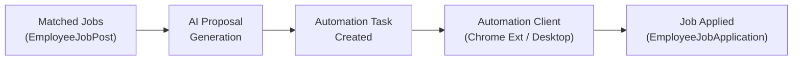
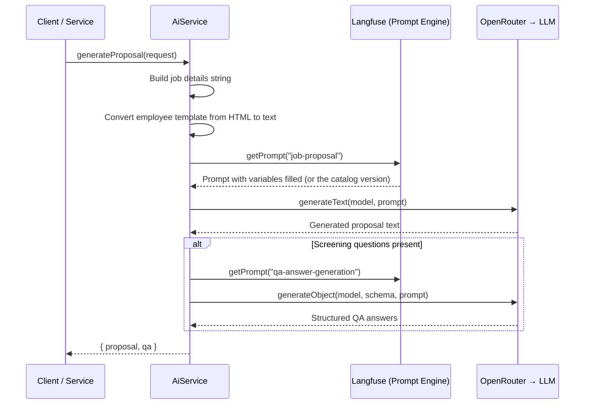
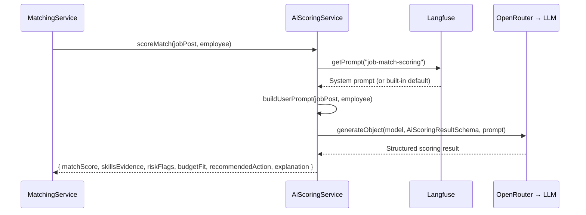
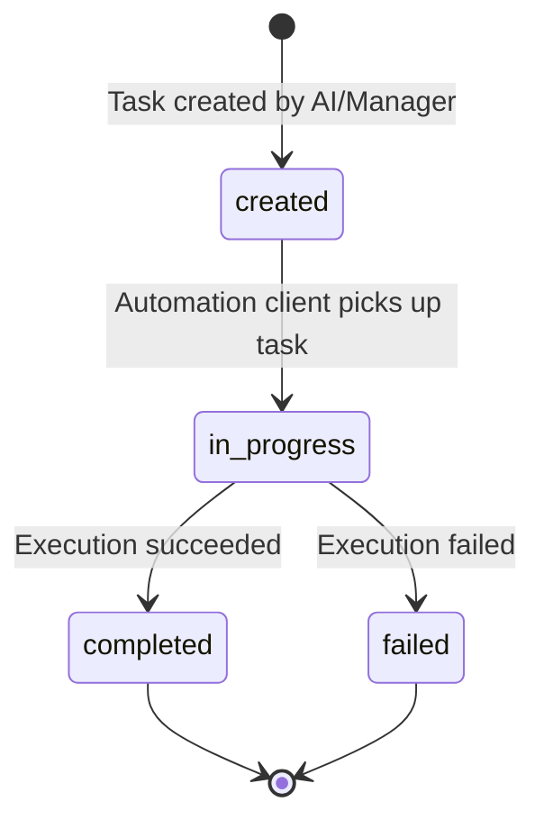
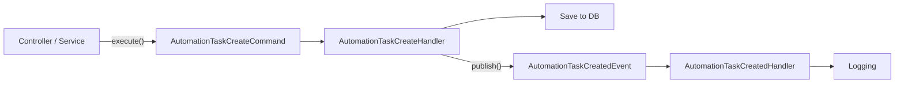
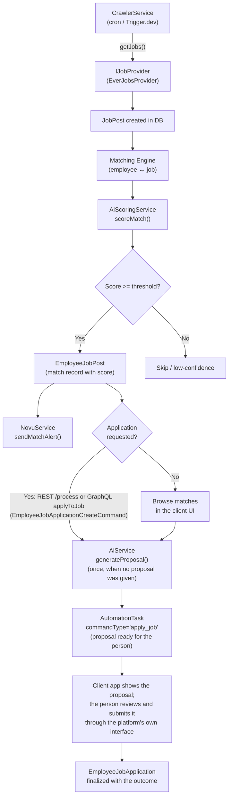
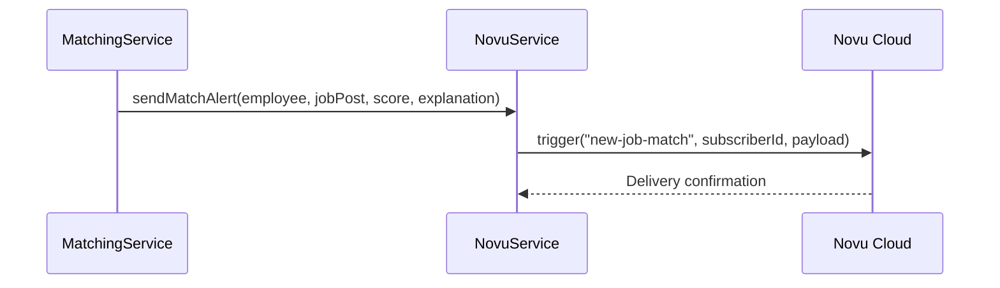

# AI & Automation Architecture

How Gauzy AI uses AI for proposal generation, job-match scoring, and how the automation task system drives client-side job applications.

---

## Table of Contents

- [Overview](#overview)
- [AI Proposal Generation](#ai-proposal-generation)
    - [How It Works](#how-it-works)
    - [Langfuse Prompt Management](#langfuse-prompt-management)
    - [Prompt Strategy](#prompt-strategy)
    - [API Endpoint](#api-endpoint)
    - [Request / Response](#request--response)
    - [Per-Tenant AI Credentials](#per-tenant-ai-credentials)
- [AI Match Scoring](#ai-match-scoring)
    - [Scoring Pipeline](#scoring-pipeline)
    - [Structured Output Schema](#structured-output-schema)
    - [Score Interpretation](#score-interpretation)
- [QA Answer Generation](#qa-answer-generation)
- [Automation Task System](#automation-task-system)
    - [What is an Automation Task?](#what-is-an-automation-task)
    - [Task Lifecycle](#task-lifecycle)
    - [CQRS Flow](#cqrs-flow)
    - [Command Types](#command-types)
    - [Command Payloads](#command-payloads)
    - [The Automation Client](#the-automation-client)
- [Job Application Pipeline](#job-application-pipeline)
- [Notification Pipeline (Novu)](#notification-pipeline-novu)
- [Configuration](#configuration)
- [Future: Sim Studio Integration](#future-sim-studio-integration)

---

## Overview

The AI and automation system forms the "action" layer of Gauzy AI — it turns matched jobs into submitted applications:



Three main subsystems:

1. **AI Service** — generates cover letter proposals using **Vercel AI SDK** with **OpenRouter** for multi-model routing and **Langfuse** for prompt management and observability
2. **AI Scoring Service** — scores job-to-employee matches (0–100%) with structured output (skills evidence, risk flags, budget fit, recommended actions)
3. **Automation Tasks** — CQRS-based command queue that drives the client-side automation system

---

## AI Proposal Generation

### How It Works

When an employee is matched with a job, the system can auto-generate a tailored proposal:



### Langfuse Prompt Management

Prompts live in [Langfuse](https://langfuse.com/), an open-source LLM engineering platform, where they are versioned, edited without a deployment and linked to the traces of the generations that used them. `PromptService` (`packages/prompts`) is the registry client; every AI call asks it for a prompt by name.

| Config     | Env Var               | Description                                |
| ---------- | --------------------- | ------------------------------------------ |
| Public Key | `LANGFUSE_PUBLIC_KEY` | Langfuse public API key                    |
| Secret Key | `LANGFUSE_SECRET_KEY` | Langfuse secret API key                    |
| Base URL   | `LANGFUSE_HOST`       | Langfuse server URL (self-hosted or cloud) |

The **prompt catalog** (`packages/prompts/src/catalog.ts`) holds the built-in text of every prompt. It is the fallback when Langfuse is not configured, unreachable or lacks a prompt, so the platform always works, and it seeds the registry:

```bash
yarn prompts:seed            # create missing prompts, update the ones whose production text differs from the catalog
yarn prompts:seed --check    # report only (exit 1 when something would change)
```

Each change creates a new prompt version labelled `production` in Langfuse. The catalog is the source of truth: a seed run replaces any production version whose text differs from the catalog, so an edit made in Langfuse lasts only until the next seed run; make lasting changes in the catalog (and seed), use `--check` to see what a run would replace. The `production` label is what runs.

**Generation traces.** With the Langfuse keys set, the AI SDK's generation spans (`experimental_telemetry`) are exported to Langfuse through OpenTelemetry (`src/utils/tracer.ts`, `langfuse-vercel` exporter) and `promptTelemetry()` links each generation to the prompt version it ran with, so prompt changes can be compared on real traffic. `LANGFUSE_TRACING_ENABLED=false` keeps the prompt registry but turns the export off; `OTEL_ENABLED=true` additionally sends all spans to the OTLP endpoint (SigNoz by default). The tracer loads `.env` itself (it runs before the application's configuration module), so a local `.env` is enough.

### Prompt Strategy

| Prompt Name            | Used by                                    | Variables                        |
| ---------------------- | ------------------------------------------ | -------------------------------- |
| `job-proposal`         | Proposal generation (user prompt)          | `existingTemplate`, `jobDetails` |
| `qa-answer-generation` | Screening-question answers (system prompt) | —                                |
| `job-match-scoring`    | Match scoring (system prompt)              | —                                |

**Proposal prompt variables:**

| Variable           | Content                                                                              |
| ------------------ | ------------------------------------------------------------------------------------ |
| `existingTemplate` | Employee's proposal template (HTML → plaintext), including experience, skills, links |
| `jobDetails`       | Job title, category, skills, description                                             |

**Model settings:**

| Setting       | Value                                             |
| ------------- | ------------------------------------------------- |
| Provider      | OpenRouter (multi-model routing)                  |
| Default Model | `openai/gpt-4o` (configurable via `OPENAI_MODEL`) |
| Telemetry     | Enabled via `experimental_telemetry`              |

### API Endpoint

```
POST /api/ai/generate-proposal
```

### Request / Response

**Request body:**

```typescript
{
  title: string;           // Job title
  description: string;     // Job description (HTML or text)
  skills: string;          // Comma-separated skills
  category: string;        // Job category
  employeeTemplate: string; // Employee's existing proposal template (HTML)
  qa?: string;             // Optional screening Q&A to include (JSON string)
}
```

**Response body:**

```typescript
{
  proposal: string;  // AI-generated cover letter text
  qa?: string;       // AI-generated QA answers (JSON string) or pass-through
}
```

### Per-Tenant AI Credentials

Each tenant can have its own AI provider credentials, stored in `TenantApiKey`:

```
X-OPENAI-SECRET-KEY: sk-...
X-OPENAI-ORGANIZATION-ID: org-...
```

When present, these override the global AI config, enabling multi-tenant billing.

---

## AI Match Scoring

**Minimum hourly rate (issue #52).** Before AI scoring, an hourly job is matched to an employee only when the job's upper hourly bound (structured compensation fields or the budget text, e.g. `$20-$50/hr` → 50) is at least the employee's `preferredRate`. Equal matches; a missing rate on either side, a fixed-price job or an unparseable budget never excludes a job. Implemented in `packages/employee-job-post/src/rate-fit.ts`.


The `AiScoringService` evaluates how well a job post matches an employee's profile using structured AI output.

### Scoring Pipeline



### Structured Output Schema

The scoring result uses a **Zod schema** with Vercel AI SDK's `generateObject()` for type-safe structured output:

```typescript
{
	matchScore: number; // 0–100 overall match score
	skillsEvidence: Array<{
		required: string; // Skill required by the job
		employee: string; // Employee's matching skill
		match: boolean; // Whether the skill strongly matches
	}>;
	riskFlags: Array<{
		flag: string; // Short risk flag name
		severity: 'low' | 'medium' | 'high';
		detail: string; // Detailed explanation
	}>;
	budgetFit: 'good_fit' | 'under_budget' | 'over_budget' | 'unknown';
	recommendedAction: 'apply_now' | 'ask_question' | 'skip' | 'review';
	explanation: string; // Human-readable summary
}
```

### Score Interpretation

| Score Range | Meaning                                |
| ----------- | -------------------------------------- |
| 90–100      | Perfect match — strongly recommend     |
| 70–89       | Good match — worth applying            |
| 50–69       | Moderate — review carefully            |
| 30–49       | Weak match — significant gaps          |
| 0–29        | Poor match — likely not worth pursuing |

**Prompt Langfuse key:** `job-match-scoring`

**Default model:** `openai/gpt-4o-mini` (configurable via `AI_SCORING_MODEL`)

---

## QA Answer Generation

When a job posting has screening questions (common on Upwork), the AI generates professional answers:

- Uses `generateObject()` with the `AiQAResultSchema` Zod schema
- Each question gets a tailored answer based on the job context and employee profile
- Falls back to returning the original QA string if generation fails (never blocks the proposal pipeline)

**Output schema:**

```typescript
{
	answers: Array<{
		question: string; // The original screening question
		answer: string; // AI-generated professional answer
	}>;
}
```

---

## Automation Task System

### What is an Automation Task?

An `AutomationTask` is a **command record** stored in the database that instructs the client-side automation system to perform an action. Think of it as a job queue where:

- **Gauzy AI** produces tasks (creates records)
- **Automation Client** consumes tasks (polls, executes, reports results)

### Task Lifecycle



| Status        | Description                                                    |
| ------------- | -------------------------------------------------------------- |
| `created`     | Task is queued, waiting for an automation client to pick it up |
| `in_progress` | An automation client is actively executing the task            |
| `completed`   | Task finished successfully                                     |
| `failed`      | Task execution failed (error details in `commandResult`)       |

### CQRS Flow

Task creation follows the CQRS pattern:



**Outcome notification.** When a task's status changes to `completed`, `failed` or `timeout`, whatever wrote it (REST or GraphQL update, a task created already finished, the stale-task clean-up that sets `timeout`), `AutomationTaskFinishedEvent` is published once after the commit (`AutomationTaskSubscriber`, a TypeORM subscriber, and `OpsService.cleanupStaleTasks()`), and the employee receives one Novu `automation-task-complete` notification. Non-terminal changes and repeats of the same status send nothing.

### Command Types

| Command Type | Description                     | Requires Employee? |
| ------------ | ------------------------------- | ------------------ |
| `login`      | Log in to a source platform     | Yes                |
| `logout`     | Log out from a source platform  | Yes                |
| `apply`      | Apply to a job with a proposal  | Yes                |
| `getJob`     | Fetch details of a specific job | No                 |
| `getJobs`    | Fetch a list of jobs            | No                 |

### Command Payloads

The `command` field is a JSON string. Its structure varies by `commandType`:

**Login:**

```json
{
	"commandType": "login",
	"providerCode": "upwork",
	"username": "employee@company.com",
	"password": "encrypted-password",
	"secret": "2FA-code"
}
```

**Apply:**

```json
{
	"commandType": "apply",
	"providerCode": "upwork",
	"employeeJobPostId": "match-uuid",
	"proposal": "Full proposal text...",
	"qa": "[{\"q\": \"Experience?\", \"a\": \"10 years\"}]"
}
```

### The Automation Client

The **Ever Gauzy AI Automation** system (`ever-co/ever-gauzy-ai-automation`) runs on employee PCs and consists of:

| Component           | Technology           | Purpose                                                     |
| ------------------- | -------------------- | ----------------------------------------------------------- |
| Chrome Extension    | Plasmo + Chrome APIs | Automates browser actions (filling forms, clicking buttons) |
| Desktop App         | Electron             | Manages the Chrome Extension, handles OS-level tasks        |
| Mechanical Turk App | Electron + Web UI    | Displays tasks for human operators who apply manually       |

The client:

1. Polls Gauzy AI for tasks with `status = 'created'`
2. Updates task to `in_progress`
3. Executes the command (e.g., navigates to Upwork, fills out the proposal form)
4. Updates task to `completed` or `failed` with `commandResult`

---

## Job Application Pipeline

The full pipeline from job discovery to application:



---

## Notification Pipeline (Novu)

The `NovuService` sends notifications via [Novu](https://novu.co/): match alerts (`new-job-match`) when job matches exceed the notification threshold, the outcome of an automation task (`automation-task-complete`, once per transition to `completed` / `failed` / `timeout`), application status changes (`application-status`, once per real change of `appliedStatus`, e.g. through `finalize`), and the daily digest. The match alert:



**Novu workflow:** `new-job-match`

**Payload:**

| Field          | Description                 |
| -------------- | --------------------------- |
| `jobTitle`     | Title of the matched job    |
| `matchScore`   | AI match score (0–100)      |
| `explanation`  | AI explanation of the match |
| `providerCode` | Source platform code        |
| `jobPostId`    | Job post ID                 |
| `employeeId`   | Employee ID                 |

**Graceful degradation:** If `NOVU_API_KEY` is not configured, notifications are silently skipped — never blocking the matching pipeline.

---

## Configuration

### AI Configuration

| Env Var              | Required | Description                                         |
| -------------------- | -------- | --------------------------------------------------- |
| `OPENROUTER_API_KEY` | Yes      | OpenRouter API key for multi-model routing          |
| `OPENAI_MODEL`       | No       | Default model for proposals (e.g., `openai/gpt-4o`) |
| `AI_SCORING_MODEL`   | No       | Model for AI scoring (e.g., `openai/gpt-4o-mini`)   |

### Langfuse Configuration

| Env Var               | Required | Description         |
| --------------------- | -------- | ------------------- |
| `LANGFUSE_PUBLIC_KEY` | No       | Langfuse public key |
| `LANGFUSE_SECRET_KEY` | No       | Langfuse secret key |
| `LANGFUSE_HOST`       | No       | Langfuse server URL |

### Novu Configuration

| Env Var        | Required | Description  |
| -------------- | -------- | ------------ |
| `NOVU_API_KEY` | No       | Novu API key |

### Trigger.dev Configuration

| Env Var               | Required | Description                   |
| --------------------- | -------- | ----------------------------- |
| `TRIGGER_DEV_ENABLED` | No       | Enable Trigger.dev scheduling |
| `TRIGGER_SECRET_KEY`  | No       | Trigger.dev secret key        |

### Legacy Configuration (Removed)

| Env Var                       | Status  | Replacement                           |
| ----------------------------- | ------- | ------------------------------------- |
| `PROMPTS_API_URL`             | Removed | `LANGFUSE_HOST`                       |
| `PROMPTS_API_KEY`             | Removed | `LANGFUSE_SECRET_KEY`                 |
| `PROMPTS_API_ENVIRONMENT`     | Removed | N/A (Langfuse uses prompt versioning) |
| `OPENAI_API_KEY`              | Removed | `OPENROUTER_API_KEY`                  |
| `OPENAI_ORGANIZATION_ID`      | Removed | OpenRouter handles routing            |
| `OPENAI_VISION_PREVIEW_MODEL` | Removed | Configured via model name             |

---

## Future: Sim Studio Integration

In production, the AI pipeline will be orchestrated via **Sim Studio** (sim.ai) — a visual canvas for building multi-step AI agent workflows:

| Current                         | Future                                |
| ------------------------------- | ------------------------------------- |
| Single prompt call via Langfuse | Multi-step agent graphs in Sim Studio |
| Cron / Trigger.dev crawling     | Event-driven workflow triggers        |
| AiService direct call           | Agent workflow execution              |
| AiScoringService direct call    | Scoring as workflow node              |

Sim Studio will enable:

- Visual drag-and-drop workflow design
- Multi-agent collaboration (one agent matches jobs, another generates proposals, another reviews)
- Human-in-the-loop approval steps
- A/B testing of different prompt strategies
