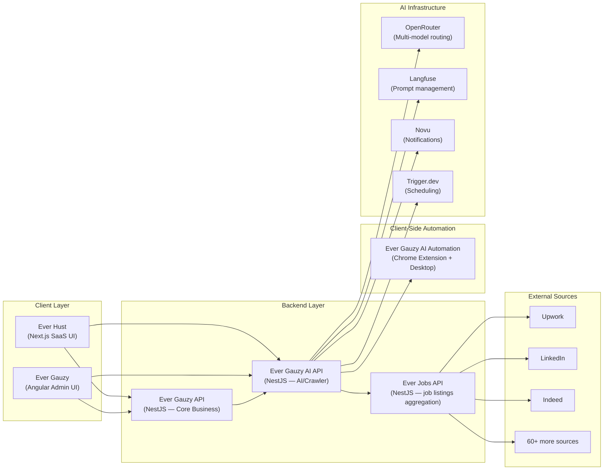
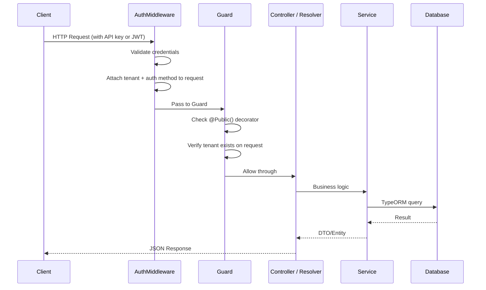
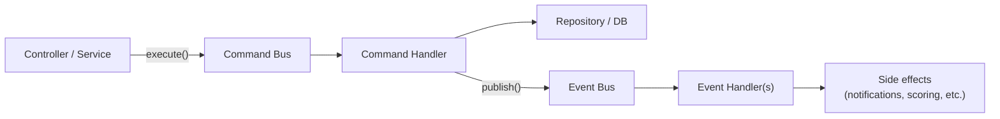
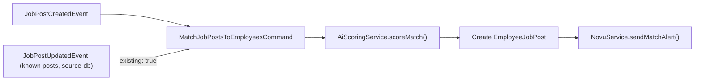

# Architecture Overview

**Ever® Gauzy AI™ — Open Business Services and Intelligence Platform**

APIs and services that gather, analyze and act on business data for the Ever Gauzy ecosystem: job markets and integrations (Ever Jobs, Upwork's official API), AI matching and proposals, screenshot analysis, notifications and scheduling, with a plugin system and AI agents on top.

A high-level guide to the Ever Gauzy AI system architecture, deployment topology, module layout, and how the major components interact.

---

## Table of Contents

- [System Landscape](#system-landscape)
- [Ever Gauzy AI API — Internal Architecture](#ever-gauzy-ai-api--internal-architecture)
    - [Technology Stack](#technology-stack)
    - [Package Map](#package-map)
    - [Shared Package Map](#shared-package-map)
- [Request Lifecycle](#request-lifecycle)
- [CQRS & Event-Driven Workflows](#cqrs--event-driven-workflows)
- [Scheduling & Cron](#scheduling--cron)
- [Database](#database)
- [Deployment](#deployment)
- [Cross-System References](#cross-system-references)
- [Adding New Packages](#adding-new-packages)

---

## System Landscape

Ever Gauzy AI is one backend in a multi-system platform. Five major systems collaborate:



| System                       | Purpose                                                                                          | Repository                         |
| ---------------------------- | ------------------------------------------------------------------------------------------------ | ---------------------------------- |
| **Ever Gauzy API**           | Core business: tenants, orgs, users, employees, roles, campaigns, pipelines, criteria, templates | `ever-co/ever-gauzy`               |
| **Ever Gauzy AI API**        | AI/crawler: job searching, matching, scoring, proposal generation, automation tasks              | `ever-co/ever-gauzy-ai`            |
| **Ever Hust**                | SaaS frontend: browse jobs, apply, track, configure, AI chat                                     | `ever-hust/ever-hust`                |
| **Ever Jobs API**            | Job aggregation: collects listings from 60+ job boards / ATS platforms through their public listings and APIs, normalizes data | `ever-jobs/ever-jobs`                |
| **Ever Gauzy AI Automation** | Client-side companion: presents prepared proposals; the person reviews and submits applications   | `ever-co/ever-gauzy-ai-automation` |

> [!NOTE]
> **Ever Hust is a standalone product and its integration with Gauzy / Gauzy AI is optional.**
> Hust can run entirely on its own (its only hard dependency is the **Ever Jobs API**); the
> `Ever Hust → Ever Gauzy API` and `Ever Hust → Gauzy AI API` edges above are **opt-in** seams
> used in the agency/company scenario (assisted applications, and identity/employee sync via SSO). Gauzy AI
> exposes the contracts; Hust opts in.

---

## Ever Gauzy AI API — Internal Architecture

### Technology Stack

| Layer             | Technology                                                                  |
| ----------------- | --------------------------------------------------------------------------- |
| **Framework**     | NestJS 10.x                                                                 |
| **Language**      | TypeScript 5.x                                                              |
| **API**           | REST (Swagger) + GraphQL (Apollo, code-first)                               |
| **ORM**           | TypeORM                                                                     |
| **Database**      | PostgreSQL (production), SQLite (development)                               |
| **AI**            | Vercel AI SDK + OpenRouter (multi-model) + Langfuse (observability/prompts) |
| **Patterns**      | CQRS (Command Bus + Event Bus), Sagas                                       |
| **Scheduling**    | `cron` (dev), Trigger.dev + Sim Studio (production)                         |
| **Notifications** | Novu (`@novu/api`)                                                          |

### Package Map

The `packages/` directory contains the application's feature packages, referenced as `@packages/*`:

```
packages/
├── ai/                     # AI proposal generation + scoring (OpenRouter + Langfuse)
│   ├── ai.service.ts       #   Proposal generation with QA answers
│   ├── ai-scoring.service.ts   # Job-employee match scoring (structured output)
│   └── image-analyze.*     #   Image analysis service
├── auth/                   # Authentication middleware + guards (API Key + Bearer Token)
├── automation-task/        # Automation task CQRS (login, apply, getJob, etc.)
│   ├── commands/           #   AutomationTaskCreateCommand
│   ├── events/             #   AutomationTaskCreatedEvent
│   ├── handlers/           #   Command + event handlers
│   └── resolvers/          #   GraphQL resolvers
├── config/                 # Configuration service (env vars, feature flags)
├── core/                   # Base entities and shared utilities
├── crawler/                # Cron-driven multi-provider job crawler
│   └── crawler.service.ts  #   Provider iteration, criteria dedup, liveness checks
├── dashboard/              # Dashboard stats and metrics
├── dto/                    # Shared DTOs
├── employee/               # Employee management
├── employee-job-application/  # Job application tracking (proposals, status)
├── employee-job-post/      # Employee ↔ JobPost matching records
├── entities/               # TypeORM entity definitions (12 entities)
├── ever-jobs-client/       # HTTP client for the Ever Jobs API
├── health/                 # Health check endpoint
├── job-post/               # Job post CRUD + CQRS
├── job-providers/          # Job provider system
│   ├── common/             #   IJobProvider interface + DI token
│   ├── provider-db/        #   source-db: searches local job cache
│   └── provider-ever-jobs/ #   Wraps Ever Jobs API via EverJobsClientService
├── novu/                   # Novu notification integration
├── seeds/                  # Database seeding
├── source-config/          # Generic source credential storage (GraphQL CRUD)
├── tenant/                 # Tenant management
├── tenant-api-key/         # Per-tenant AI provider credentials
├── trigger/                # Trigger.dev production scheduling
└── user/                   # User management
```

### Shared Package Map

Packages reference each other via TypeScript path aliases (`@packages/*`):

| Package                      | Path                         | Purpose                             |
| ---------------------------- | ---------------------------- | ----------------------------------- |
| `@packages/ai`               | `packages/ai/`               | AI proposal generation + scoring    |
| `@packages/config`           | `packages/config/`           | `ConfigurationService` for env vars |
| `@packages/crawler`          | `packages/crawler/`          | Multi-provider job crawler          |
| `@packages/ever-jobs-client` | `packages/ever-jobs-client/` | HTTP client for Ever Jobs API       |
| `@packages/entities`         | `packages/entities/`         | TypeORM entity definitions          |
| `@packages/novu`             | `packages/novu/`             | Novu notification service           |
| `@packages/trigger`          | `packages/trigger/`          | Trigger.dev scheduling              |

---

## Request Lifecycle



Every request passes through:

1. **AuthMiddleware** — extracts and validates credentials (API Key/Secret or Bearer Token)
2. **AuthGuard / TenantAuthGuard** — enforces that the request has a valid tenant attached (unless the route is marked `@Public()`)
3. **Controller / Resolver** — REST or GraphQL handler
4. **Service** — business logic, may use CQRS Command Bus
5. **TypeORM** — database access

---

## CQRS & Event-Driven Workflows

Gauzy AI uses NestJS CQRS for write-heavy operations:



**Current CQRS modules:**

| Module                     | Commands                              | Events                               | Side Effects               |
| -------------------------- | ------------------------------------- | ------------------------------------ | -------------------------- |
| **JobPost**                | `JobPostCreateCommand`                | `JobPostCreatedEvent`, `JobPostUpdatedEvent` | Match new posts to employees (re-match known ones for changed employees), notify |
| **AutomationTask**         | `AutomationTaskCreateCommand`         | `AutomationTaskCreatedEvent`         | Logging, status tracking   |
| **EmployeeJobApplication** | `EmployeeJobApplicationCreateCommand` | `EmployeeJobApplicationCreatedEvent` | Auto-create AutomationTask |

**Saga: Job Post → Match → Notify**



This pattern enables:

- Decoupled write logic from side effects
- Async processing of job post creation (crawler doesn't block on DB writes)
- Multi-step Saga workflows (matching pipelines, notification chains)

---

## Scheduling & Periodic Jobs

The platform has five periodic jobs. `OpsService` (`packages/ops`) implements the cross-tenant ones; `CrawlerService` implements crawling and liveness. Two schedulers can run them, and both call the same code:

| Job                     | Default schedule          | What it does                                                                 |
| ----------------------- | ------------------------- | ---------------------------------------------------------------------------- |
| `crawl`                 | every 10 min              | `CrawlerService.crawl()`: every job provider, every active employee's criteria |
| `liveness-check`        | hourly                    | `CrawlerService.runLivenessChecks()`: closes job posts that are gone (up to 50 per run: never-checked first, open ones again after `LIVENESS_RECHECK_HOURS`, default 24) |
| `score-pending-matches` | hourly (`15 * * * *`)     | `OpsService.scorePendingMatches()`: AI-scores matches saved without a score; each match is claimed before the AI call (`scoringStartedAt`, `scoringAttempts`), gives up after 3 failures (`scoringError`), one run at a time per process |
| `daily-digest`          | 08:00 (`0 8 * * *`)       | `OpsService.sendDailyDigest()`: Novu `daily-digest` per employee with activity |
| `cleanup-stale-tasks`   | 02:00 (`0 2 * * *`)       | `OpsService.cleanupStaleTasks()`: times out automation tasks pending > 24 h  |

| Scheduler                                   | When                                                          | How                                                                                                                                    |
| ------------------------------------------- | ------------------------------------------------------------- | -------------------------------------------------------------------------------------------------------------------------------------- |
| **In-process cron** (`SchedulerService`)    | default; off with `LOCAL_CRON_ENABLED=false` or when Trigger.dev is enabled | node-cron through `@nestjs/schedule`; schedules from `CRAWL_INTERVAL_MINUTES` / `CRAWL_CRON`, `LIVENESS_CHECK_INTERVAL_MINUTES` / `LIVENESS_CRON`, `SCORE_PENDING_CRON` (+ `SCORE_PENDING_LIMIT`), `DIGEST_CRON`, `CLEANUP_CRON`, `SCHEDULER_TIMEZONE`; a job never overlaps itself (intervals must be expressible as cron, otherwise startup fails) |
| **Trigger.dev** (`src/trigger/*.ts`)        | `TRIGGER_DEV_ENABLED=true` + `TRIGGER_SECRET_KEY`             | tasks deployed with `yarn trigger:deploy` run on Trigger.dev workers and call back into the API over HTTP with the service token         |
| **External** (Kubernetes CronJob, curl)     | any time                                                      | `POST /api/ops/*` and `/api/crawler/*` with `X-SERVICE-TOKEN: $SERVICE_API_TOKEN`                                                        |

`GET /api/ops/schedule` reports the jobs, their cron expressions and which scheduler is active. Run the in-process cron on **one** replica only (set `LOCAL_CRON_ENABLED=false` on the others, or use Trigger.dev / a Kubernetes CronJob calling `/api/ops/*`): every replica with it enabled would run every job. All five jobs exist as Trigger.dev scheduled tasks too (`score-pending-matches` included), so enabling Trigger.dev loses nothing. `TriggerService` only configures the Trigger.dev SDK so the API can enqueue event tasks (`score-matches`, `process-application`); it does not register tasks at runtime. `/api/ops/*` accepts the service token only (`ServiceTokenOnlyGuard`): a tenant credential cannot run other tenants' jobs.

The crawler:

1. Loads all active employees with search criteria
2. Deduplicates criteria by (keyword + location + country + jobType + isRemote)
3. For each registered `IJobProvider`, calls `getJobsForCriteria()` per unique criterion
4. Dispatches results to the `JobPostCreateCommand` handler for DB upsert
5. The CQRS saga handles matching, scoring, and notifications

---

## Database

Gauzy AI maintains its own database, separate from the core Gauzy API DB:

| Environment          | Database   | Config             |
| -------------------- | ---------- | ------------------ |
| Development          | SQLite     | `DB_TYPE=sqlite`   |
| Staging / Production | PostgreSQL | `DB_TYPE=postgres` |

**Entity definitions** live in `packages/entities/src/`:

| Entity                   | Table                      | Purpose                                           |
| ------------------------ | -------------------------- | ------------------------------------------------- |
| `AutomationTask`         | `automation_task`          | Command queue for client-side automation          |
| `Employee`               | `employee`                 | Employee profiles (skills, criteria, preferences) |
| `EmployeeJobApplication` | `employee_job_application` | Job application records (proposals, status)       |
| `EmployeeJobPost`        | `employee_job_post`        | Employee ↔ JobPost match records (with scores)    |
| `JobPost`                | `job_post`                 | Aggregated job posts from all sources             |
| `JobSearchCriterion`     | `job_search_criterion`     | Per-employee search criteria                      |
| `Organization`           | `organization`             | Organization shadow records                       |
| `SourceConfig`           | `source_config`            | Per-source authentication credentials             |
| `Tenant`                 | `tenant`                   | Tenant shadow records                             |
| `TenantApiKey`           | `tenant_api_key`           | Per-tenant AI provider credentials                |
| `User`                   | `user`                     | User shadow records                               |

### Schema Management

On PostgreSQL the schema is owned by **TypeORM migrations** (`packages/config/src/migrations/`), run automatically at startup (`DB_MIGRATIONS_RUN`, default `true`; each migration in its own transaction) and available from the CLI:

| Command                                       | Purpose                                                                                  |
| --------------------------------------------- | ---------------------------------------------------------------------------------------- |
| `yarn migration:generate <Name>`              | Apply pending migrations to the database given by `DB_*`, then diff the entities into a new migration |
| `yarn migration:generate:ephemeral <Name>`    | Same, against a disposable embedded PostgreSQL (no local server needed)                  |
| `yarn migration:run` / `migration:revert`     | Apply / roll back one migration on `DB_*`                                                |
| `yarn migration:show`                         | List applied and pending migrations                                                      |
| `yarn test:e2e:ephemeral`                     | Run the migrations on an empty embedded PostgreSQL and assert the entities match the result |
| `yarn test:e2e:migrations`                    | Same against your own `DB_*`; destructive, so it only runs with `DB_DISPOSABLE=true`        |

Every migration is imported in `packages/config/src/migrations/index.ts` (the rspack bundle cannot glob for files). Databases that predate migrations (schema created by `synchronize`) are baselined by `InitialSchema`, which only records itself when the tables already exist; `RenameLegacySearchCriteria` renames the pre-2026 `employee_upwork_jobs_search_criterion` table and `BackfillTenantOwnership` fills `tenantId` on rows written before tenant scoping. `DB_SYNCHRONIZE=true` (never in production) lets TypeORM sync the schema directly; sql.js / SQLite (tests, demos) always synchronize.

---

## Plugins

Capabilities are packaged as plugins (`packages/plugin`: `GauzyAiPlugin`, `definePlugin`, `PluginsModule`, `PluginRegistry`). `src/plugins.ts` lists the installed ones; `PluginsModule.forRoot` imports the modules of the enabled plugins and collects their `IJobProvider`s under `JOB_PROVIDERS_TOKEN` for the crawler. Job sources today: `ever-jobs`, `upwork` (official API, read-only), `source-db`; AI, notification, prompt-registry and scheduling capabilities are listed as plugins too. `GAUZY_AI_PLUGINS_DISABLED` switches any of them off; `GET /api/plugins` shows the state. See [Plugins](./plugins.md).

---

## Deployment

- Deployed to a **Kubernetes cluster** alongside Ever Gauzy API
- Docker images built via GitHub Actions CI/CD
- Separate pods for API server and (optionally) worker processes
- Environment variables managed via Kubernetes Secrets / ConfigMaps

---

## Cross-System References

Gauzy AI does **not** own general business entities (users, employees, tenants, orgs). Instead, it creates local shadow records and cross-references them via `external*Id` fields:

| Gauzy AI Field       | Points to                      |
| -------------------- | ------------------------------ |
| `externalTenantId`   | Tenant in Ever Gauzy API       |
| `externalOrgId`      | Organization in Ever Gauzy API |
| `externalEmployeeId` | Employee in Ever Gauzy API     |
| `externalUserId`     | User in Ever Gauzy API         |

This approach keeps the databases decoupled while allowing data correlation.

---

## Adding New Packages

To add a new feature package:

1. Create a directory under `packages/<name>/`
2. Add an `index.ts` barrel export
3. Create a `src/` subdirectory with:
    - A NestJS module class (`.module.ts`)
    - Controller (REST) and/or resolver (GraphQL)
    - Service with business logic
    - If write-heavy, add CQRS commands/events/handlers
4. Add a TypeScript path alias in `tsconfig.json`: `"@packages/<name>/*": ["packages/<name>/src/*"]`
5. Register the module in `schema.module.ts` (for GraphQL) or `app.module.ts`
6. Add documentation to `docs/`
7. Add unit tests (`.spec.ts`) alongside the service files
