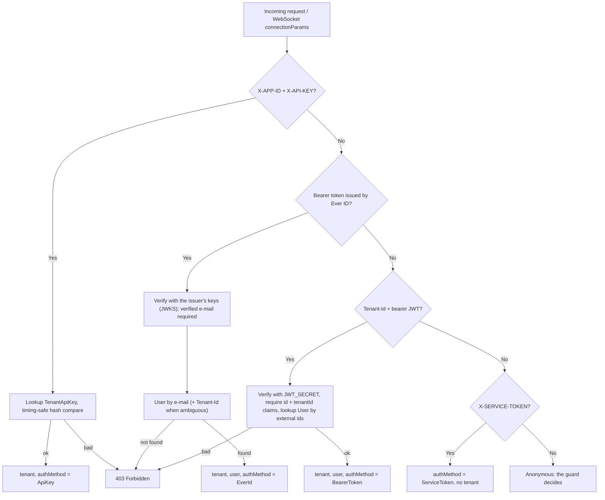

# Authentication & Authorization

How Gauzy AI authenticates and authorizes requests from client applications, other backends, browser-based users and schedulers.

---

## Table of Contents

-   [Overview](#overview)
-   [Authentication Methods](#authentication-methods)
    -   [Method 1: API Key + Secret](#method-1-api-key--secret)
    -   [Method 2: Ever ID (OpenID Connect)](#method-2-ever-id-openid-connect)
    -   [Method 3: Legacy Tenant JWT](#method-3-legacy-tenant-jwt)
    -   [Method 4: Service Token](#method-4-service-token)
    -   [Which Method to Use](#which-method-to-use)
-   [Auth Pipeline](#auth-pipeline)
    -   [AuthMiddleware and TenantAuthService](#authmiddleware-and-tenantauthservice)
    -   [AuthGuard / TenantAuthGuard](#authguard--tenantauthguard)
    -   [GraphQL Subscriptions (WebSocket)](#graphql-subscriptions-websocket)
    -   [Public Routes](#public-routes)
-   [Tenant Isolation](#tenant-isolation)
-   [Data Model](#data-model)
    -   [TenantApiKey Entity](#tenantapikey-entity)
    -   [User Entity](#user-entity)
-   [Security Features](#security-features)
-   [Configuration Switches](#configuration-switches)
-   [Per-Tenant AI Credentials](#per-tenant-ai-credentials)
-   [Integration Examples](#integration-examples)

---

## Overview

Every request is authenticated by one of four credentials. Three of them identify a **tenant** (and, for user tokens, a **user** of that tenant); the service token identifies an internal scheduler and carries no tenant.

| Method                       | Headers                                                   | Use Case                                                              |
| ---------------------------- | --------------------------------------------------------- | --------------------------------------------------------------------- |
| **API Key + Secret**         | `X-APP-ID` + `X-API-KEY`                                  | Server-to-server (Ever Gauzy API → Gauzy AI, backend services)        |
| **Ever ID (OpenID Connect)** | `Authorization: Bearer <token>` (+ `Tenant-Id` if needed) | Users of the Ever platform (browser, mobile, CLI) signed in with Ever ID |
| **Legacy Tenant JWT**        | `Tenant-Id` + `Authorization: Bearer <jwt>`               | Tokens issued by an integrating platform with a shared `JWT_SECRET`    |
| **Service Token**            | `X-SERVICE-TOKEN`                                         | Schedulers calling `/api/ops/*` and `/api/crawler/*` across tenants    |

The tenant (or the service identity) is attached to the request by the middleware and verified by the guard layer before any controller or resolver runs. Gauzy AI does not run its own sign-in, password store or session service: users come from **Ever ID** (the Ever platform's identity provider, Zitadel at `https://auth.ever.co`), machines use API keys.

---

## Authentication Methods

### Method 1: API Key + Secret

For server-to-server communication. The API key identifies the tenant's application; the secret authenticates it.

**Headers:**

```
X-APP-ID: <apiKey>
X-API-KEY: <apiSecret>
```

**How it works:**

1. The middleware reads `X-APP-ID` and `X-API-KEY`
2. Looks up a `TenantApiKey` record by `apiKey`
3. Hashes the provided secret with SHA-256
4. Performs a **timing-safe comparison** against the stored hash
5. If valid, attaches `request.tenant` and sets `request.authMethod = 'ApiKey'`

**Example (curl):**

```bash
curl -X GET http://localhost:3005/api/job-posts \
  -H "X-APP-ID: your-app-id" \
  -H "X-API-KEY: your-api-secret"
```

### Method 2: Ever ID (OpenID Connect)

For people. The token is an OpenID Connect ID token or access token issued by Ever ID (`EVER_ID_ISSUER_URL`, e.g. `https://auth.ever.co`; unset means Ever ID sign-in is off). Gauzy AI never sees a password and needs no shared secret: signatures are checked against the issuer's published keys (JWKS, discovered from `/.well-known/openid-configuration` and cached).

**Headers:**

```
Authorization: Bearer <OpenID Connect token>
Tenant-Id: <tenantId>            # only when the user belongs to several tenants
```

**How it works:**

1. The middleware finds a bearer token whose `iss` claim is the Ever ID issuer
2. `EverIdService` verifies signature, issuer, expiry and, when `EVER_ID_AUDIENCE` is set, the audience (OAuth client ids)
3. The token must carry a **verified e-mail** (`email_verified: true`)
4. The user is matched by e-mail against active Gauzy AI `User` records with an active tenant. One match → that tenant. Several (the e-mail exists in several tenants) → `Tenant-Id` must name one (Gauzy AI's tenant id or the integrating platform's external tenant id); otherwise 403
5. The tenant's `TenantApiKey` (per-tenant AI provider keys) is attached when one exists
6. `request.tenant`, `request.user` and `request.authMethod = 'EverId'` are set; the token's `exp` bounds WebSocket connections (see below)

Users are created in Gauzy AI by the integrating platform (Ever Gauzy registers its users and employees through the `users` / `employees` GraphQL mutations); Ever ID sign-in does not create tenants or users by itself.

**Example (JavaScript, browser):**

```javascript
const response = await fetch('https://api.gauzy.ai/api/job-posts', {
	headers: { Authorization: `Bearer ${everIdAccessToken}` },
});
```

### Method 3: Legacy Tenant JWT

For integrating platforms that issue their own user tokens (historically the Ever Gauzy API) and share `JWT_SECRET` with Gauzy AI. Kept for compatibility; new integrations should use Ever ID or API keys.

**Headers:**

```
Tenant-Id: <externalTenantId>
Authorization: Bearer <jwt>
```

**How it works:**

1. The middleware reads `Tenant-Id` and the bearer token (a token issued by Ever ID takes Method 2 instead)
2. Verifies the JWT with `JWT_SECRET`
3. Requires the `id` and `tenantId` claims (a signed token without identity claims is rejected, never widened to "any user")
4. Looks up the `User` by `externalUserId`, `externalEmployeeId` and `externalTenantId`
5. Looks up the `TenantApiKey` for the user's tenant (required)
6. Attaches `request.tenant`, `request.user` and sets `request.authMethod = 'BearerToken'`

### Method 4: Service Token

For schedulers (Trigger.dev tasks, Kubernetes CronJobs, the in-process cron calling itself) that run jobs across all tenants: `/api/ops/*` and `/api/crawler/*`.

```
X-SERVICE-TOKEN: <SERVICE_API_TOKEN>
```

The token is compared in constant time with `SERVICE_API_TOKEN`; the request gets `authMethod = 'ServiceToken'` and **no tenant**, so tenant-scoped endpoints reject it. Cross-tenant endpoints (`/api/ops/*`, `/api/crawler/*`) opt in with `@Public()` plus `ServiceTokenOnlyGuard`: the service token is the only accepted credential there, because those jobs touch every tenant's data; a tenant API key or user token gets `401`. (`ServiceTokenGuard`, which admits the service token **or** any authenticated tenant credential, is for endpoints that are safe for a tenant to call: today that is `GET /api/plugins`, the read-only list of the deployment's enabled capabilities.)

### Which Method to Use

| Scenario                                                     | Recommended Method       |
| ------------------------------------------------------------ | ------------------------ |
| Backend service calling Gauzy AI (Ever Gauzy API, plugins)   | API Key + Secret         |
| Website / SPA / mobile app used by a signed-in person         | Ever ID (OpenID Connect) |
| Integrating platform issuing its own user tokens (compat)    | Legacy Tenant JWT        |
| CI/CD or scripted automation on behalf of a tenant           | API Key + Secret         |
| Schedulers running cross-tenant jobs                         | Service Token            |

---

## Auth Pipeline

### AuthMiddleware and TenantAuthService

`TenantAuthService.authenticate(headers)` implements the rules above for a set of headers and is used by two transports: the HTTP `AuthMiddleware` (every request, before guards) and the GraphQL WebSocket handshake (`connectionParams`). It returns what to attach (`authMethod`, `tenant`, `tenantApiKey`, `user`, `expiresAt`), `null` for an anonymous request, and throws `403` for a credential that is present but wrong.



Key behavior:

-   The middleware **does not reject** requests that lack credentials; that is the guard's job
-   The first matching credential wins; no double authentication
-   Credentials are never logged (not the secret, not its hash, not the token)
-   Per-tenant AI provider credentials come from the stored `TenantApiKey` of the authenticated tenant (attached as `request.tenantApiKey`); request headers are not consulted

### AuthGuard / TenantAuthGuard

`AuthGuard` is registered globally (`APP_GUARD`) and extends `TenantAuthGuard`:

1. Routes or classes with `@Public()` pass
2. Otherwise `request.tenant` must have been set by the middleware; if not, `401 Unauthorized`

The guard is **GraphQL-aware**: it extracts the request from HTTP and GraphQL execution contexts alike, including subscriptions.

### GraphQL Subscriptions (WebSocket)

`graphql-ws` connections authenticate with the same rules (`packages/auth/src/graphql-ws-auth.ts`): the client sends the headers above as `connectionParams`.

-   A wrong credential refuses the socket; no credential gives an anonymous socket whose operations the guard rejects
-   Every operation re-validates the credentials, and an authenticated connection re-validates them periodically (`WS_REVALIDATE_INTERVAL_MS`, default 5 min) and at the token's `exp`; the socket is closed with code `4401` as soon as they stop validating (disabled key, expired token) or identify a different tenant or user than at connect time
-   Subscription events are filtered by the subscriber's tenant (and employee when given)

### Public Routes

Routes decorated with `@Public()` bypass the tenant guard:

```typescript
import { Public } from '@packages/core/decorators/public.decorator';

@Public()
@Get('health')
healthCheck() {
  return { status: 'ok' };
}
```

Cross-tenant operational endpoints (`/api/ops/*`, `/api/crawler/*`) combine it with `@UseGuards(ServiceTokenOnlyGuard)`: the service token is the only accepted credential there, because those jobs touch every tenant's data (`ServiceTokenGuard`, which also admits a tenant credential, remains for endpoints that are safe to run per tenant); see Method 4.

---

## Tenant Isolation

Authentication yields a tenant; everything after it is scoped to that tenant:

-   GraphQL types carry `@Authorize(TenantAuthorizer)` (filters every query by `tenantId`) and the `Before*ByTenantHook`s, which stamp `tenantId` on creates/updates, scope updates and deletes, drop client-supplied `id`s from create and update payloads and verify that referenced employees belong to the tenant
-   `Tenant` itself is readable only as the caller's own tenant (`SelfTenantAuthorizer`)
-   REST and service lookups use `currentTenantWhere()` / `requireCurrentTenantId()` from the request context (`AsyncLocalStorage`, initialised for HTTP by the middleware and for GraphQL operations by a global interceptor); a row of another tenant is reported as `404`
-   The cross-tenant jobs (`/api/ops/*` and `/api/crawler/*`) run only behind the service token: a tenant credential cannot start other tenants' searches or AI processing

---

## Data Model

### TenantApiKey Entity

Stored in `tenant_api_key`:

| Column                 | Type   | Description                                               |
| ---------------------- | ------ | --------------------------------------------------------- |
| `id`                   | UUID   | Primary key                                               |
| `tenantId`             | UUID   | Foreign key to Tenant                                     |
| `apiKey`               | string | Public app identifier (sent in `X-APP-ID`)                |
| `apiSecret`            | string | SHA-256 hash of the secret (compared against `X-API-KEY`) |
| `openAiSecretKey`      | string | Optional OpenAI API key for this tenant                   |
| `openAiOrganizationId` | string | Optional OpenAI Organization ID                           |

> **Important:** `apiSecret` stores the **hash**, not the raw secret. The raw secret is only known to the client.

### User Entity

Stored in `user`. One record per user **per tenant** (shadow records registered by the integrating platform); used to map a user token to a tenant:

| Column             | Type   | Description                                                            |
| ------------------ | ------ | ---------------------------------------------------------------------- |
| `id`               | UUID   | Primary key (Gauzy AI's own ID)                                        |
| `tenantId`         | UUID   | The tenant this record belongs to                                      |
| `email`            | string | E-mail; Ever ID tokens are matched on it (verified by the issuer)      |
| `externalUserId`   | string | User ID in the external system (legacy tenant JWT)                     |
| `externalTenantId` | string | Tenant ID in the external system (legacy tenant JWT, `Tenant-Id`)      |
| `hash`             | string | Unused by Gauzy AI auth; excluded from serialization                   |

---

## Security Features

| Feature                     | Implementation                                                                                              |
| --------------------------- | ----------------------------------------------------------------------------------------------------------- |
| **Timing-safe comparison**  | `crypto.timingSafeEqual()` for API secrets and the service token                                            |
| **SHA-256 hashing**         | API secrets are never stored in plaintext, only their SHA-256 hashes                                        |
| **Asymmetric verification** | Ever ID tokens are verified with the issuer's public keys (`jose`); no shared secret to leak                 |
| **Verified identity**       | Ever ID tokens must carry `email_verified: true`; the e-mail decides the user, never a client-supplied id    |
| **Claim checks**            | Legacy JWTs must carry `id` and `tenantId`; a signed token without them is rejected                         |
| **No credential logging**   | Secrets, hashes and tokens never reach the logs                                                             |
| **Credential expiry on WS** | WebSocket connections are re-validated periodically and closed at token expiry / key revocation (`4401`)    |
| **Password exclusion**      | `User.hash` uses `@Exclude({ toPlainOnly: true })`                                                          |
| **Secret masking**          | Source configuration API masks `clientSecret`, `accessToken`, `refreshToken` in responses                   |

---

## Configuration Switches

| Variable                       | Default                | Effect                                                                                         |
| ------------------------------ | ---------------------- | ---------------------------------------------------------------------------------------------- |
| `EVER_ID_ISSUER_URL`           | _(unset)_              | OpenID Connect issuer whose tokens are accepted as Ever ID user tokens, e.g. `https://auth.ever.co`; unset turns Method 2 off. Compared verbatim with the token's `iss` |
| `EVER_ID_AUDIENCE`             | _(empty)_              | Comma-separated OAuth client ids the token's `aud` must contain; empty accepts any audience      |
| `EVER_ID_DISCOVERY_TIMEOUT_MS` | `10000`                | Deadline for fetching the issuer's OpenID configuration / keys                                   |
| `JWT_SECRET`                   | _(unset)_              | Shared secret for the legacy tenant JWT path; unset turns Method 3 off                          |
| `SERVICE_API_TOKEN`            | _(unset)_              | Service token for schedulers; unset turns Method 4 off                                          |
| `WS_REVALIDATE_INTERVAL_MS`    | `300000`               | How often an authenticated WebSocket connection re-validates its credentials                    |
| `IS_DISABLE_API_KEY_AUTH`      | `false`                | Disables Method 1                                                                               |
| `IS_DISABLE_BEARER_TOKEN_AUTH` | `false`                | Disables Methods 2 and 3                                                                        |
| `IS_DISABLE_AUTH`              | `false`                | **Kill switch**: the guards let everything through (local development only)                    |

> [!CAUTION]
> Never set `IS_DISABLE_AUTH=true` in production. It is designed only for local development convenience.

---

## Per-Tenant AI Credentials

The `TenantApiKey` record can carry the tenant's own OpenAI credentials (`openAiSecretKey`, `openAiOrganizationId`). They are attached to the request as `request.tenantApiKey` when the tenant authenticates (API key, Ever ID or legacy JWT) and the AI services use them instead of the global default, enabling per-tenant AI billing. Request headers are **not** a way to supply them: credentials are read from the stored record only.

---

## Integration Examples

### Ever Gauzy API → Gauzy AI (server-to-server)

```typescript
// In the Ever Gauzy API (integration-ai plugin)
const response = await axios.get(`${GAUZY_AI_URL}/api/job-posts`, {
	headers: {
		'X-APP-ID': process.env.GAUZY_AI_APP_ID,
		'X-API-KEY': process.env.GAUZY_AI_API_SECRET,
	},
});
```

### Browser app with Ever ID

```typescript
// Any Ever platform front-end: the user signed in with Ever ID (OpenID Connect)
const response = await fetch(`${GAUZY_AI_URL}/api/job-posts`, {
	headers: {
		Authorization: `Bearer ${session.accessToken}`,
		// only when the user belongs to several tenants:
		'Tenant-Id': session.tenantId,
	},
});
```

### GraphQL subscription (WebSocket)

```typescript
import { createClient } from 'graphql-ws';

const client = createClient({
	url: 'wss://api.gauzy.ai/graphql',
	connectionParams: { 'X-APP-ID': appId, 'X-API-KEY': apiSecret }, // or { Authorization: `Bearer ${token}` }
});
```

### Scheduler calling an ops endpoint

```bash
curl -X POST https://api.gauzy.ai/api/ops/digest \
  -H "X-SERVICE-TOKEN: $SERVICE_API_TOKEN" -H "Content-Type: application/json" -d '{}'
```

### Testing with auth disabled

```bash
# Start with auth disabled for local development
IS_DISABLE_AUTH=true yarn start:dev

# All endpoints are accessible without credentials
curl http://localhost:3005/api/job-posts
```
