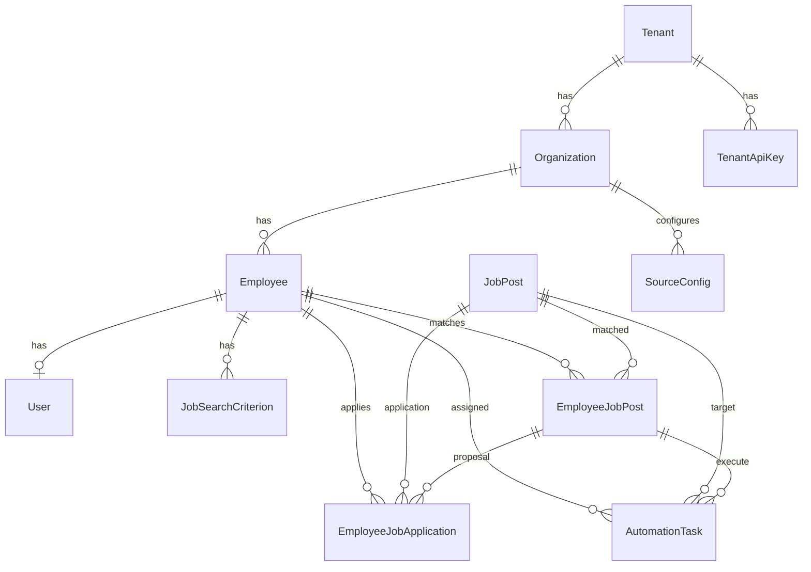

# Data Model Reference

Complete reference for all TypeORM entities in the Gauzy AI database. All entities extend from base classes that provide `id`, `createdAt`, `updatedAt`, and tenant/org scoping fields.

---

## Table of Contents

- [Entity Relationship Diagram](#entity-relationship-diagram)
- [Base Classes](#base-classes)
- [Core Entities](#core-entities)
    - [Tenant](#tenant)
    - [Organization](#organization)
    - [User](#user)
    - [TenantApiKey](#tenantapikey)
- [Employee & Matching](#employee--matching)
    - [Employee](#employee)
    - [JobSearchCriterion](#jobsearchcriterion)
    - [JobPost](#jobpost)
    - [EmployeeJobPost](#employeejobpost)
    - [EmployeeJobApplication](#employeejobapplication)
- [Automation](#automation)
    - [AutomationTask](#automationtask)
- [Source Configuration](#source-configuration)
    - [SourceConfig](#sourceconfig)

---

## Entity Relationship Diagram

---

## Base Classes

All entities inherit common fields:

| Field        | Type     | Description                          |
| ------------ | -------- | ------------------------------------ |
| `id`         | UUID     | Primary key (auto-generated)         |
| `createdAt`  | DateTime | Record creation timestamp            |
| `updatedAt`  | DateTime | Last modification timestamp          |
| `isActive`   | Boolean  | Soft-active flag                     |
| `isArchived` | Boolean  | Soft-archive flag                    |
| `tenantId`   | UUID     | Tenant scoping (in TenantBase+)      |
| `orgId`      | UUID     | Organization scoping (in TenantOrg+) |

---

## Core Entities

### Tenant

**Table:** `tenant`

Shadow record for tenants from the external Gauzy API.

| Field  | Type   | Required | Description         |
| ------ | ------ | -------- | ------------------- |
| `name` | string | No       | Tenant display name |

### Organization

**Table:** `organization`

Shadow record for organizations.

| Field  | Type   | Required | Description               |
| ------ | ------ | -------- | ------------------------- |
| `name` | string | No       | Organization display name |

### User

**Table:** `user`

Shadow record for users from the external Gauzy API.

| Field              | Type   | Required | Description          |
| ------------------ | ------ | -------- | -------------------- |
| `externalUserId`   | string | No       | User ID in Gauzy API |
| `externalTenantId` | string | No       | Tenant in Gauzy      |
| `email`            | string | No       | User email           |
| `firstName`        | string | No       | First name           |
| `lastName`         | string | No       | Last name            |

### TenantApiKey

**Table:** `tenant_api_key`

Per-tenant AI provider credentials for multi-tenant billing.

| Field                  | Type   | Required | Description                      |
| ---------------------- | ------ | -------- | -------------------------------- |
| `apiKey`               | string | Yes      | API authentication key           |
| `apiSecret`            | string | Yes      | API authentication secret        |
| `openAiSecretKey`      | string | No       | Per-tenant OpenAI/OpenRouter key |
| `openAiOrganizationId` | string | No       | OpenAI organization ID           |

---

## Employee & Matching

### Employee

**Table:** `employee` — Unique: `(tenantId, orgId, firstName, lastName)`

| Field                 | Type                 | Required | Description                     |
| --------------------- | -------------------- | -------- | ------------------------------- |
| `externalTenantId`    | string               | No       | Tenant in external Gauzy        |
| `externalOrgId`       | string               | No       | Org in external Gauzy           |
| `externalEmployeeId`  | string               | No       | Employee in external Gauzy      |
| `firstName`           | string               | No       | First name                      |
| `lastName`            | string               | No       | Last name                       |
| `linkedInId`          | string               | No       | LinkedIn profile ID             |
| `jobType`             | string               | No       | Preference: "Hourly" or "Fixed" |
| **AI Scoring Fields** |                      |          |                                 |
| `bio`                 | text                 | No       | Professional bio/summary        |
| `skillsSummary`       | text                 | No       | Comma-separated skills          |
| `preferredRate`       | decimal              | No       | Preferred hourly rate (USD)     |
| `experienceSummary`   | text                 | No       | Work history summary            |
| `customFields`        | JSON                 | No       | Flexible key-value metadata     |
| **Relations**         |                      |          |                                 |
| `user`                | User                 | No       | OneToOne → User (CASCADE)       |
| `jobSearchCriteria`   | JobSearchCriterion[] | —        | OneToMany → criteria            |

### JobSearchCriterion

**Table:** `job_search_criterion`

Source-agnostic search criteria configured per employee. Used by the crawler to determine what to search for.

| Field          | Type     | Required | Description                    |
| -------------- | -------- | -------- | ------------------------------ |
| `category`     | string   | No       | Job category                   |
| `categoryId`   | string   | No       | Category ID                    |
| `occupation`   | string   | No       | Occupation                     |
| `occupationId` | string   | No       | Occupation ID                  |
| `jobType`      | string   | No       | "fixed" or "hourly"            |
| `keyword`      | string   | No       | Search keyword                 |
| `location`     | string   | No       | Geographic location            |
| `country`      | string   | No       | Country filter                 |
| `isRemote`     | boolean  | No       | Remote-only flag               |
| `hoursOld`     | number   | No       | Max listing age (hours)        |
| **Relations**  |          |          |                                |
| `employee`     | Employee | Yes      | ManyToOne → Employee (CASCADE) |

### JobPost

**Table:** `job_post` — Unique: `(providerCode, providerJobId)`

The largest entity — aggregated job posts from all sources. ~50 fields covering job details, compensation, company info, and enrichment data.

**Core Fields:**

| Field            | Type   | Required | Description                                  |
| ---------------- | ------ | -------- | -------------------------------------------- |
| `providerCode`   | string | Yes      | Source platform (e.g., "linkedin", "upwork") |
| `providerJobId`  | string | No       | Job ID in the source platform                |
| `ingestedBy`     | string | No       | Provider that stored it ("ever-jobs", "upwork"); picks the liveness verifier |
| `title`          | string | No       | Job title                                    |
| `description`    | text   | No       | Full job description (HTML/text)             |
| `jobUrl`         | string | No       | Direct link to the job posting               |
| `jobType`        | string | No       | "Hourly" or "Fixed"                          |
| `jobStatus`      | string | No       | "Open", "Completed", "Cancelled"             |
| `searchCategory` | string | No       | Search category used to find this job        |

**Compensation Fields:**

| Field                  | Type   | Description                  |
| ---------------------- | ------ | ---------------------------- |
| `budget`               | string | Budget text (e.g., "$5,000") |
| `compensationMin`      | float  | Minimum compensation         |
| `compensationMax`      | float  | Maximum compensation         |
| `compensationCurrency` | string | Currency code                |
| `compensationInterval` | string | "hourly", "yearly", etc.     |

**Company Fields:**

| Field                 | Type   | Description          |
| --------------------- | ------ | -------------------- |
| `companyName`         | string | Company name         |
| `companyLogo`         | string | Company logo URL     |
| `companyIndustry`     | string | Industry             |
| `companyNumEmployees` | string | Employee count       |
| `companyRating`       | float  | Company rating (0-5) |
| `companyUrl`          | string | Company website      |

**Enrichment / Search Fields:**

| Field             | Type    | Description      |
| ----------------- | ------- | ---------------- |
| `skills`          | text    | Required skills  |
| `experienceRange` | string  | Experience range |
| `isRemote`        | boolean | Remote flag      |
| `location`        | string  | Job location     |
| `duration`        | string  | Job duration     |
| `jobLevel`        | string  | Seniority level  |
| `jobFunction`     | string  | Job function     |
| `employmentType`  | string  | Employment type  |

**Liveness Fields:**

| Field             | Type     | Description                        |
| ----------------- | -------- | ---------------------------------- |
| `isExpired`       | boolean  | Whether job is no longer available |
| `expiryCheckedAt` | DateTime | Last liveness check timestamp      |

### EmployeeJobPost

**Table:** `employee_job_post` — Unique: `(tenantId, orgId, employeeId, jobPostId)`

A match record between an employee and a job post, enriched with AI scoring data.

| Field               | Type         | Required | Description                                   |
| ------------------- | ------------ | -------- | --------------------------------------------- |
| `providerCode`      | string       | Yes      | Source platform                               |
| `providerJobId`     | string       | No       | Job ID in source                              |
| `jobDateCreated`    | DateTime     | No       | Job creation date                             |
| `jobStatus`         | string       | No       | Job status                                    |
| `jobType`           | string       | No       | Hourly/Fixed                                  |
| `isApplied`         | boolean      | No       | Whether employee applied                      |
| `appliedStatus`     | string       | No       | "succeed", "failed"                           |
| `appliedDate`       | DateTime     | No       | When proposal was sent                        |
| **AI Scoring**      |              |          |                                               |
| `matchScore`        | decimal(5,2) | No       | AI score 0–100                                |
| `skillsEvidence`    | JSON         | No       | Skills evidence array                         |
| `riskFlags`         | JSON         | No       | Risk flags array                              |
| `budgetFit`         | string       | No       | "good_fit", "under_budget", "over_budget"     |
| `recommendedAction` | string       | No       | "apply_now", "ask_question", "skip", "review" |
| `explanation`       | text         | No       | AI match explanation                          |
| `modelUsed`         | string       | No       | AI model identifier                           |
| `scoredAt`          | DateTime     | No       | When scoring was performed                    |
| **Relations**       |              |          |                                               |
| `employee`          | Employee     | Yes      | ManyToOne (CASCADE)                           |
| `jobPost`           | JobPost      | No       | ManyToOne                                     |

### EmployeeJobApplication

**Table:** `employee_job_application`

The actual job application — stores the proposal, QA answers, rate, and terms.

| Field                      | Type            | Required | Description                       |
| -------------------------- | --------------- | -------- | --------------------------------- |
| `providerCode`             | string          | Yes      | Source platform                   |
| `providerJobId`            | string          | No       | Job ID in source                  |
| `providerJobApplicationId` | string          | No       | Application ID in source          |
| `jobDateCreated`           | DateTime        | No       | Job creation date                 |
| `jobStatus`                | string          | No       | Job status at time of apply       |
| `jobType`                  | string          | No       | Hourly/Fixed                      |
| `isViewedByClient`         | boolean         | No       | Client viewed the proposal        |
| `appliedDate`              | DateTime        | No       | When applied                      |
| `appliedStatus`            | string          | No       | "succeed", "failed"               |
| `proposal`                 | string          | No       | Full proposal text (cover letter) |
| `isProposalGeneratedByAI`  | boolean         | No       | AI-generated flag                 |
| `proposalTemplate`         | string          | No       | Template used to build proposal   |
| `qa`                       | JSON string     | No       | Q&A pairs                         |
| `attachments`              | JSON string     | No       | Attachment URLs                   |
| `rate`                     | number          | No       | Hourly rate proposed              |
| `terms`                    | JSON string     | No       | Fixed-cost terms/milestones       |
| **Relations**              |                 |          |                                   |
| `employeeJobPost`          | EmployeeJobPost | Yes      | ManyToOne                         |
| `employee`                 | Employee        | Yes      | ManyToOne (CASCADE)               |
| `jobPost`                  | JobPost         | Yes      | ManyToOne                         |

---

## Automation

### AutomationTask

**Table:** `automation_task`

Command queue for the client-side automation system. See [AI & Automation](ai-and-automation.md) for full task lifecycle documentation.

| Field                | Type            | Required | Description                                     |
| -------------------- | --------------- | -------- | ----------------------------------------------- |
| `providerCode`       | string          | Yes      | Target platform                                 |
| `commandType`        | string          | Yes      | "login", "apply", "getJob", "getJobs", "logout" |
| `command`            | JSON string     | No       | Command payload                                 |
| `commandResult`      | JSON string     | No       | Execution result                                |
| `status`             | string          | Yes      | "created", "in_progress", "completed", "failed" |
| `isBroadcast`        | boolean         | Yes      | Broadcast to all employees? (default: false)    |
| `providerJobId`      | string          | No       | Job ID in provider                              |
| `jobDateCreated`     | DateTime        | No       | When job was created                            |
| `jobStatus`          | string          | No       | Job status                                      |
| `jobType`            | string          | No       | Hourly/Fixed                                    |
| `executionTime`      | number          | No       | Seconds to execute                              |
| `executedDate`       | DateTime        | No       | When task was executed                          |
| `externalTenantId`   | string          | No       | External tenant reference                       |
| `externalOrgId`      | string          | No       | External org reference                          |
| **Relations**        |                 |          |                                                 |
| `employeeJobPost`    | EmployeeJobPost | No       | ManyToOne — match record                        |
| `employee`           | Employee        | No       | ManyToOne — assigned employee (CASCADE)         |
| `executedByEmployee` | Employee        | No       | ManyToOne — who executed it                     |
| `jobPost`            | JobPost         | No       | ManyToOne — target job                          |

---

## Source Configuration

### SourceConfig

**Table:** `source_config`

Per-tenant OAuth2 credentials and settings for any job source (Upwork, LinkedIn, etc.).

| Field              | Type    | Required | Description                                  |
| ------------------ | ------- | -------- | -------------------------------------------- |
| `sourceCode`       | string  | Yes      | Source identifier ("upwork", "linkedin")     |
| `externalTenantId` | string  | No       | External tenant reference                    |
| `externalOrgId`    | string  | No       | External org reference                       |
| `sourceOrgId`      | string  | No       | Org ID in the source platform                |
| **OAuth2**         |         |          |                                              |
| `grantType`        | string  | No       | "client_credentials" or "authorization_code" |
| `clientId`         | string  | No       | OAuth2 client ID                             |
| `clientSecret`     | string  | No       | OAuth2 client secret                         |
| `accessToken`      | string  | No       | OAuth2 access token                          |
| `refreshToken`     | string  | No       | OAuth2 refresh token                         |
| **Settings**       |         |          |                                              |
| `useProxy`         | boolean | No       | Use proxy for requests                       |
| `cacheTtlSeconds`  | number  | No       | Cache TTL override                           |
| `resultsWanted`    | number  | No       | Default results per crawl                    |
