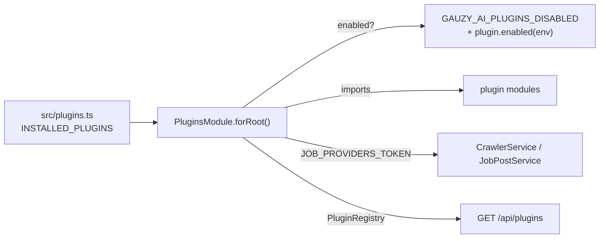

# Plugins

Gauzy AI is a small platform of capabilities: job sources, AI functions, notifications, prompt registry, scheduling. Each capability is a **plugin**: a self-contained package with its NestJS module(s), the environment variables it reads and, for job sources, the `IJobProvider` it contributes to the crawler. Plugins are loaded at startup from one list and can be switched off per deployment without a code change.

---

## Table of Contents

-   [How plugins are loaded](#how-plugins-are-loaded)
-   [Built-in plugins](#built-in-plugins)
-   [Switching plugins off](#switching-plugins-off)
-   [Writing a plugin](#writing-a-plugin)
    -   [A job source](#a-job-source)
    -   [A capability](#a-capability)
-   [Upwork](#upwork)
-   [Inspecting a deployment](#inspecting-a-deployment)

---

## How plugins are loaded



1. `src/plugins.ts` lists the installed plugins (`INSTALLED_PLUGINS`).
2. `PluginsModule.forRoot(INSTALLED_PLUGINS)` (imported by `AppModule`) decides for each plugin whether it is on: the `GAUZY_AI_PLUGINS_DISABLED` override first, then the plugin's own `enabled(env)` rule, otherwise on.
3. The modules of the enabled plugins are imported; the `IJobProvider` classes they export are collected under `JOB_PROVIDERS_TOKEN`, which the crawler and the liveness check inject.
4. `PluginRegistry` keeps the decisions; `GET /api/plugins` reports them.

The contract lives in `packages/plugin` (`GauzyAiPlugin`, `definePlugin`, `PluginsModule`, `PluginRegistry`).

---

## Built-in plugins

| Plugin                | Kind          | Package                                 | On when                                             |
| --------------------- | ------------- | --------------------------------------- | --------------------------------------------------- |
| `ever-jobs`           | job-source    | `packages/job-providers/provider-ever-jobs` | `EVER_JOBS_API_URL` is set                       |
| `upwork`              | job-source    | `packages/job-providers/provider-upwork`    | always loaded; searches run when credentials exist (see [Upwork](#upwork)) |
| `source-db`           | job-source    | `packages/job-providers/provider-db`        | `SOURCE_DB_ENABLED=true`                         |
| `match-scoring`       | ai            | `packages/ai` (`AiScoringService`)      | `OPENROUTER_API_KEY` is set                         |
| `proposal-generation` | ai            | `packages/ai` (`AiService`)             | `OPENROUTER_API_KEY` is set                         |
| `screenshot-analysis` | ai            | `packages/ai` (`ImageAnalyzeService`)   | always (deployment key or the tenant's own OpenAI key per request) |
| `langfuse`            | observability | `packages/prompts`                      | Langfuse keys set (otherwise the built-in catalog)  |
| `novu`                | notifications | `packages/novu`                         | `NOVU_API_KEY` is set                               |
| `trigger-dev`         | scheduling    | `packages/trigger`, `src/trigger`       | `TRIGGER_DEV_ENABLED=true`                          |

Job-source plugins contribute providers (a disabled one is not loaded at all). Capability plugins describe modules that `AppModule` wires directly; their switch is **enforced by the implementation**: a disabled `match-scoring` / `proposal-generation` / `screenshot-analysis` answers `503` to the calls it would serve, `novu` sends nothing, `langfuse` stays in catalog mode, and `trigger-dev` off means the in-process scheduler runs the jobs even if `TRIGGER_DEV_ENABLED=true` — callbacks from schedules still deployed on Trigger.dev workers (they send `X-Scheduler: trigger-dev`) are then refused with `409`, so a job never runs twice. `PluginRegistry` is what they consult (`pluginEnabled()`, injected by class token, optional so that standalone construction and unit tests keep everything on). The tracer applies the same switch to the Langfuse exporter before the application starts.

---

## Switching plugins off

```bash
GAUZY_AI_PLUGINS_DISABLED=upwork,source-db
```

A disabled job source is not loaded at all (its module is not imported, its provider never runs). The reason is visible in `GET /api/plugins`.

---

## Writing a plugin

### A job source

1. Create `packages/job-providers/provider-<name>/` with a provider implementing `IJobProvider` (`packages/job-providers/common`): `providerCode`, `providerName`, `isEnabled()`, `getJobsForCriteria(criterion)` (one call per unique employee search criterion), optionally `verifyJob(url, post)` (and `canVerify(post)`) for liveness checks. Map results to `JobPost` entities (`providerCode`, `providerJobId`, `title`, …) with `ingestedBy` set to the provider's `providerCode`: that is how a stored post finds its liveness verifier.
2. Export it from a NestJS module (`register()` / `fromEnv()` with the settings it needs). Per-tenant credentials belong in **source configs** (`SourceConfigService.getConfigForSource('<name>')`), never in code.
3. Describe it:

    ```ts
    export const AcmeJobsPlugin = definePlugin({
    	name: 'acme-jobs',
    	kind: 'job-source',
    	description: 'Job postings from the Acme API.',
    	env: ['ACME_API_URL', 'ACME_API_KEY'],
    	enabled: (env) => !!env.ACME_API_URL || 'ACME_API_URL is not set',
    	imports: [AcmeJobsModule.fromEnv()],
    	jobProviders: [AcmeJobsProvider],
    });
    ```

4. Add the path aliases (`tsconfig.json`, `package.json` → `jest.moduleNameMapper`, `test/jest-e2e.json`) and append the plugin to `INSTALLED_PLUGINS` in `src/plugins.ts`.
5. Unit-test the provider with a mocked HTTP client (see `upwork.provider.spec.ts`).

Only use official APIs, within their terms of service. A provider reads job postings; applying, messaging or any automated interaction with a marketplace on a user's behalf is out of scope.

### A capability

Anything that is not a job source (an AI function, a notification channel, an integration) is a module imported by `AppModule` plus a `definePlugin` entry without `jobProviders`. Give it an `enabled(env)` rule that reflects its configuration so operators can see at a glance what the deployment can do.

---

## Upwork

The `upwork` plugin reads job postings through **Upwork's official API** (GraphQL `marketplaceJobPostingsSearch`, OAuth2). It is read-only: it never applies to jobs, never messages anyone and never scrapes the website.

Credentials, in order:

1. The tenant's source config with `sourceCode: "upwork"` (`clientId` + `clientSecret` for the client-credentials grant, or a pre-obtained `accessToken`; `sourceOrgId` is sent as `X-Upwork-API-TenantId`). See [Source Integration](./source-integration.md#source-configuration-api).
2. The `UPWORK_CLIENT_ID` / `UPWORK_CLIENT_SECRET` (or `UPWORK_ACCESS_TOKEN`) variables.

Without either, the provider reports itself disabled and the crawler skips it. Credentials are **per tenant**: every search criterion carries its tenant and the provider resolves that tenant's own source config (falling back to a tenant-less, deployment-wide config or the `UPWORK_*` variables), never another tenant's. Searches take the employee's criteria (`keyword` required, `jobType` hourly/fixed) and return `JobPost`s with `providerCode: "upwork"`. The Ever Jobs plugin can also search Upwork (it forwards the same source config to the Ever Jobs service); use one or the other per deployment to avoid duplicate postings.

| Variable                 | Purpose                                                            |
| ------------------------ | ------------------------------------------------------------------ |
| `UPWORK_CLIENT_ID`       | OAuth2 application key (fallback when no source config exists)     |
| `UPWORK_CLIENT_SECRET`   | OAuth2 application secret                                          |
| `UPWORK_ACCESS_TOKEN`    | Pre-obtained access token (used as is, no client-credentials call) |
| `UPWORK_ORGANIZATION_ID` | Upwork organization id (`X-Upwork-API-TenantId`)                   |
| `UPWORK_RESULTS_WANTED`  | Results per search (default 50, max 100)                           |
| `UPWORK_API_URL`         | GraphQL endpoint (default `https://api.upwork.com/graphql`)        |
| `UPWORK_TOKEN_URL`       | Token endpoint (default `https://www.upwork.com/api/v3/oauth2/token`) |

---

## Inspecting a deployment

```bash
curl https://api.gauzy.ai/api/plugins -H "X-SERVICE-TOKEN: $SERVICE_API_TOKEN"
```

```json
[
  { "name": "ever-jobs", "kind": "job-source", "enabled": true, "env": ["EVER_JOBS_API_URL", "..."], "jobProviders": ["EverJobsProvider"] },
  { "name": "upwork", "kind": "job-source", "enabled": true, "jobProviders": ["UpworkProvider"] },
  { "name": "source-db", "kind": "job-source", "enabled": false, "reason": "SOURCE_DB_ENABLED is not true" },
  { "name": "langfuse", "kind": "observability", "enabled": false, "reason": "LANGFUSE_* keys are not set (catalog mode)" }
]
```

A tenant credential works too (the endpoint is public to any authenticated caller).
