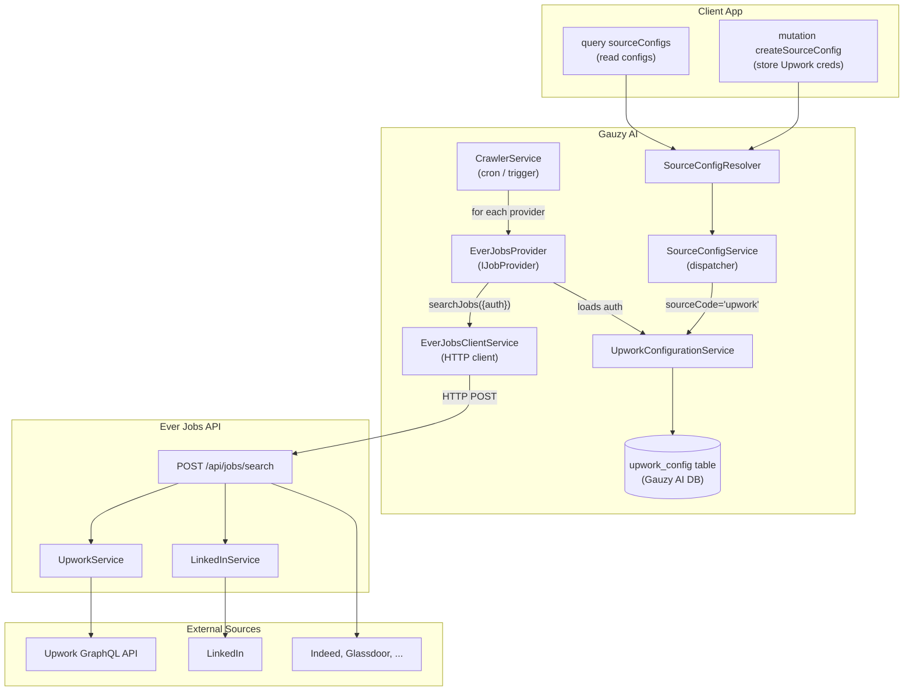
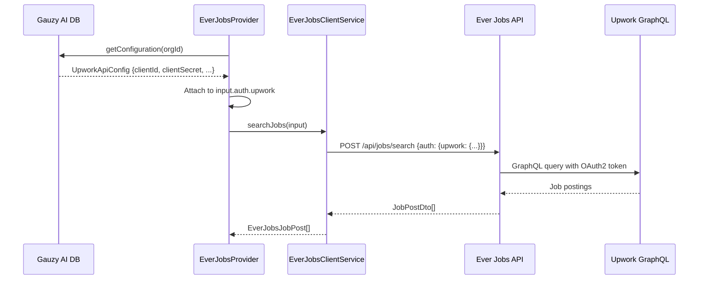

# Source Integration & Job Search Architecture

A guide for client application developers on how Gauzy AI searches for jobs across multiple sources, how source-specific configurations (auth, settings) are stored and loaded, and how to extend the system with new sources.

---

## Table of Contents

-   [Overview](#overview)
-   [Architecture Diagram](#architecture-diagram)
-   [Key Concepts](#key-concepts)
    -   [Providers](#providers)
    -   [Sources vs Providers](#sources-vs-providers)
    -   [Source Configurations](#source-configurations)
-   [Job Search Flow — End to End](#job-search-flow--end-to-end)
    -   [1. Client Stores Source Config](#1-client-stores-source-config)
    -   [2. Crawler Triggers a Job Search](#2-crawler-triggers-a-job-search)
    -   [3. Provider Loads Auth from DB](#3-provider-loads-auth-from-db)
    -   [4. Ever Jobs API Executes the Search](#4-ever-jobs-api-executes-the-search)
    -   [5. Results Flow Back](#5-results-flow-back)
-   [Source Configuration API](#source-configuration-api)
    -   [Endpoint Reference](#endpoint-reference)
    -   [Request Body Shape](#request-body-shape)
    -   [Example: Configuring Upwork](#example-configuring-upwork)
    -   [Example: Reading Config Back](#example-reading-config-back)
    -   [Secret Masking](#secret-masking)
-   [Authentication — Upwork Deep Dive](#authentication--upwork-deep-dive)
    -   [OAuth2 Grant Types](#oauth2-grant-types)
    -   [Fields Stored in DB](#fields-stored-in-db)
    -   [Environment Variable Fallback](#environment-variable-fallback)
    -   [How Auth Reaches Ever Jobs](#how-auth-reaches-ever-jobs)
-   [Data Storage](#data-storage)
    -   [Per-Source Config Tables](#per-source-config-tables)
    -   [Multi-Tenancy](#multi-tenancy)
    -   [Config Lookup Priority](#config-lookup-priority)
-   [Provider Architecture](#provider-architecture)
    -   [IJobProvider Interface](#ijobprovider-interface)
    -   [Built-In: EverJobsProvider](#built-in-everjobsprovider)
    -   [Adding a New Provider](#adding-a-new-provider)
-   [Adding a New Source](#adding-a-new-source)
    -   [Step 1: Entity & Table](#step-1-entity--table)
    -   [Step 2: Configuration Service](#step-2-configuration-service)
    -   [Step 3: Wire into SourceConfigService](#step-3-wire-into-sourceconfigservice)
    -   [Step 4: Wire into the Provider](#step-4-wire-into-the-provider)
-   [Appendix: Environment Variables](#appendix-environment-variables)

---

## Overview

Gauzy AI is a specialized backend for AI-driven job searching, matching and application assistance. It receives job postings from the Ever Jobs API (an aggregation service with many sources) and, per tenant, from Upwork's official API, through a layered architecture:

```
Client App → Gauzy AI API → Provider(s) → Ever Jobs API → External Sources
```

-   **Client apps** (Ever Hust, Gauzy UI, or any API consumer) configure source credentials via GraphQL mutations.
-   **Gauzy AI** stores those credentials in its own database, loads them at crawl time, and passes them to the appropriate external API.
-   **Ever Jobs API** is a separate microservice that actually performs the listing / API calls against external job boards (public listings and official APIs, within their terms).

This architecture means client apps **never talk directly to job boards** — they only interact with Gauzy AI's GraphQL API.

---

## Architecture Diagram



---

## Key Concepts

### Providers

A **provider** is a Gauzy AI module that implements the `IJobProvider` interface. It knows how to fetch jobs from one or more external sources. Providers are registered with the `CrawlerService`, which calls them on a schedule.

| Provider                   | Sources Covered                                                       | Transport             |
| -------------------------- | --------------------------------------------------------------------- | --------------------- |
| **EverJobsProvider**       | All 25+ Ever Jobs sources (LinkedIn, Indeed, Upwork, Glassdoor, etc.) | HTTP to Ever Jobs API |
| **UpworkProvider**         | Upwork, through its official API with the tenant's credentials        | HTTPS to Upwork API   |
| **SourceDbProvider**       | Posts already stored (re-matching)                                    | Database              |
| _(future)_ Custom providers | Any source with an official API or feed (see [Plugins](./plugins.md)) | HTTPS to that API     |

You can have **multiple providers** running simultaneously. The crawler iterates over all registered providers, calls `getJobs()` on each, and merges results into the Gauzy AI database.

### Sources vs Providers

-   A **source** is an external job board (e.g., Upwork, LinkedIn, Indeed).
-   A **provider** is the Gauzy AI module that fetches from one or more sources.
-   The **EverJobsProvider** is a single provider that covers all 25+ sources available through the Ever Jobs API.
-   A provider can also talk directly to a source's official API without Ever Jobs — the Upwork plugin does.

### Source Configurations

Each source may require its own authentication credentials and settings. These are stored **per-source** in the Gauzy AI database but managed through a **single set of GraphQL queries and mutations** (`sourceConfigs`, `sourceConfig`, `createSourceConfig`, `updateSourceConfig`, `removeSourceConfig`).

---

## Job Search Flow — End to End

### 1. Client Stores Source Config

A client app (e.g., Ever Hust admin panel) sends Upwork OAuth2 credentials to Gauzy AI via a GraphQL mutation:

```graphql
mutation {
	createSourceConfig(input: { sourceCode: "upwork", tenantId: "tenant-123", orgId: "org-456", auth: { grantType: "client_credentials", clientId: "abc123...", clientSecret: "secret..." }, settings: { useProxy: true, resultsWanted: 100 } }) {
		id
		sourceCode
		isActive
	}
}
```

Gauzy AI saves this to the `upwork_config` table.

### 2. Crawler Triggers a Job Search

The `CrawlerService` runs on a cron schedule (default: every 10 minutes in dev). It iterates over all registered providers:

```
CrawlerService.crawl()
  → for each provider in providers:
      → provider.isEnabled() ?
      → provider.getJobs()
```

### 3. Provider Loads Auth from DB

When `EverJobsProvider.getJobs()` runs, it:

1. Builds search parameters from environment config (sites, search term, location, etc.)
2. Calls `UpworkConfigurationService.getConfiguration(orgId)` to load auth from DB
3. Attaches the loaded credentials to the request as `input.auth.upwork`

```typescript
// Simplified from ever-jobs.provider.ts
const upworkConfig = await this.upworkConfigService.getConfiguration(null);
if (upworkConfig?.clientId) {
	input.auth = {
		upwork: {
			grantType: upworkConfig.grantType,
			clientId: upworkConfig.clientId,
			clientSecret: upworkConfig.clientSecret,
			accessToken: upworkConfig.accessToken,
			refreshToken: upworkConfig.refreshToken,
		},
	};
}
```

### 4. Ever Jobs API Executes the Search

`EverJobsClientService` sends an HTTP POST to the Ever Jobs API:

```http
POST http://ever-jobs-host/api/jobs/search
Content-Type: application/json

{
  "siteType": ["upwork", "linkedin", "indeed"],
  "searchTerm": "TypeScript developer",
  "resultsWanted": 100,
  "descriptionFormat": "markdown",
  "auth": {
    "upwork": {
      "grantType": "client_credentials",
      "clientId": "abc123...",
      "clientSecret": "secret..."
    }
  }
}
```

The Ever Jobs API routes the Upwork portion to its `UpworkService`, which uses the provided credentials to authenticate against the Upwork GraphQL API. Other sources (LinkedIn, Indeed) use their own scraping logic and don't need the Upwork credentials.

### 5. Results Flow Back

```
Ever Jobs API → EverJobsJobPost[] → EverJobsMapperService → JobPost[] → CrawlerService → DB
```

The mapper converts Ever Jobs DTOs to Gauzy AI's `JobPost` entity format, then the `CrawlerService` dispatches a `JobPostCreateCommand` to upsert them into the database.

---

## Source Configuration API

### GraphQL Operations

| Operation                                       | Type     | Description             |
| ----------------------------------------------- | -------- | ----------------------- |
| `createSourceConfig(input)`                     | Mutation | Create a config         |
| `sourceConfigs(sourceCode?, tenantId?, orgId?)` | Query    | List configs (filtered) |
| `sourceConfig(id)`                              | Query    | Get a single config     |
| `updateSourceConfig(id, input)`                 | Mutation | Update a config         |
| `removeSourceConfig(id)`                        | Mutation | Delete a config         |

**Arguments** for `sourceConfigs` query:

| Arg          | Type   | Description                        |
| ------------ | ------ | ---------------------------------- |
| `sourceCode` | String | Filter by source (e.g. `"upwork"`) |
| `tenantId`   | String | Filter by tenant                   |
| `orgId`      | String | Filter by organization             |

### Input Shape

```graphql
input CreateSourceConfigInput {
	sourceCode: String! # "upwork" | "linkedin" | ...
	tenantId: String # Tenant ID in the client system
	orgId: String # Organization ID in the client system
	sourceOrgId: String # Source-specific org (e.g., Upwork Org ID)
	auth: SourceAuthInput # Auth credentials
	settings: SourceSettingsInput # Settings
}

input SourceAuthInput {
	grantType: String # "client_credentials" | "authorization_code"
	clientId: String
	clientSecret: String
	accessToken: String
	refreshToken: String
}

input SourceSettingsInput {
	useProxy: Boolean
	cacheTtlSeconds: Float
	resultsWanted: Float
}
```

### Example: Configuring Upwork

**Mutation:**

```graphql
mutation {
	createSourceConfig(input: { sourceCode: "upwork", tenantId: "tenant-123", orgId: "org-456", auth: { grantType: "authorization_code", clientId: "your-upwork-client-id", clientSecret: "your-upwork-client-secret", accessToken: "pre-obtained-access-token", refreshToken: "pre-obtained-refresh-token" }, settings: { useProxy: true, resultsWanted: 50 } }) {
		id
		sourceCode
		tenantId
		orgId
		auth {
			grantType
			clientId
			clientSecret
			accessToken
			refreshToken
		}
		settings {
			useProxy
			cacheTtlSeconds
			resultsWanted
		}
		isActive
		createdAt
		updatedAt
	}
}
```

**Response** (secrets masked):

```json
{
	"data": {
		"createSourceConfig": {
			"id": "a1b2c3d4-...",
			"sourceCode": "upwork",
			"tenantId": "tenant-123",
			"orgId": "org-456",
			"auth": {
				"grantType": "authorization_code",
				"clientId": "your-upwork-client-id",
				"clientSecret": "***cret",
				"accessToken": "***oken",
				"refreshToken": "***oken"
			},
			"settings": {
				"useProxy": true,
				"cacheTtlSeconds": null,
				"resultsWanted": 50
			},
			"isActive": true,
			"createdAt": "2026-02-14T10:00:00.000Z",
			"updatedAt": "2026-02-14T10:00:00.000Z"
		}
	}
}
```

### Example: Reading Config Back

```graphql
query {
	sourceConfigs(sourceCode: "upwork", tenantId: "tenant-123") {
		id
		sourceCode
		auth {
			clientId
			clientSecret
		}
		settings {
			useProxy
			resultsWanted
		}
	}
}
```

### Secret Masking

All `GET` and response bodies **mask sensitive fields** — only the last 4 characters are shown:

| Field          | Stored Value          | Returned Value                                        |
| -------------- | --------------------- | ----------------------------------------------------- |
| `clientId`     | `abc123xyz`           | `abc123xyz` _(not masked — it's a public identifier)_ |
| `clientSecret` | `my-super-secret-key` | `***-key`                                             |
| `accessToken`  | `eyJhbGciOiJSUzI1...` | `***I1...`                                            |
| `refreshToken` | `def50200abc123...`   | `***23...`                                            |

This ensures credentials are never exposed in full through the API, even to authenticated clients.

---

## Authentication — Upwork Deep Dive

### OAuth2 Grant Types

Upwork supports two OAuth2 grant types. The choice depends on your use case:

|                           | Client Credentials           | Authorization Code             |
| ------------------------- | ---------------------------- | ------------------------------ |
| **Identity**              | App itself — no user context | Specific Upwork user           |
| **Browser needed?**       | Never                        | One-time (initial setup)       |
| **Token type**            | Access token only            | Access + refresh token         |
| **Auto-refresh?**         | Re-request on expiry         | Yes, via refresh token         |
| **Personalized results?** | No                           | Yes (tailored to user profile) |
| **Best for**              | Anonymous/public searches    | User-scoped search results     |

> **Recommendation:** Start with `client_credentials` for simplicity. If Upwork's API requires user context for `marketplaceJobPostings`, switch to `authorization_code`.

### Fields Stored in DB

The `upwork_config` table (entity: `UpworkApiConfig`) stores:

| Column             | Type    | Description                                      |
| ------------------ | ------- | ------------------------------------------------ |
| `id`               | UUID    | Primary key                                      |
| `externalTenantId` | string  | Tenant ID from the client system                 |
| `externalOrgId`    | string  | Organization ID from the client system           |
| `upworkOrgId`      | string  | Upwork-specific organization ID                  |
| `grantType`        | string  | `"client_credentials"` or `"authorization_code"` |
| `clientId`         | string  | Upwork OAuth2 application key                    |
| `clientSecret`     | string  | Upwork OAuth2 application secret                 |
| `accessToken`      | string  | Pre-obtained access token                        |
| `refreshToken`     | string  | Refresh token (authorization_code only)          |
| `useProxy`         | boolean | Use proxies for Upwork requests                  |
| `cacheTtlSeconds`  | number  | Cache TTL override                               |
| `resultsWanted`    | number  | Default results per crawl                        |
| `isActive`         | boolean | Whether this config is active                    |
| `isArchived`       | boolean | Soft-delete flag                                 |

### Environment Variable Fallback

If no config exists for a given org in the DB, `UpworkConfigurationService` falls back to environment variables:

| Env Var                | Maps to        |
| ---------------------- | -------------- |
| `UPWORK_CLIENT_ID`     | `clientId`     |
| `UPWORK_CLIENT_SECRET` | `clientSecret` |
| `UPWORK_ACCESS_TOKEN`  | `accessToken`  |
| `UPWORK_REFRESH_TOKEN` | `refreshToken` |

When falling back, the service auto-creates a DB record from the env vars so subsequent lookups use the DB.

### How Auth Reaches Ever Jobs



---

## Data Storage

### Per-Source Config Tables

Each source has its own database table. This is intentional — different sources have different auth mechanisms and settings:

| Source              | Table             | Entity              |
| ------------------- | ----------------- | ------------------- |
| Upwork              | `upwork_config`   | `UpworkApiConfig`   |
| _(future)_ LinkedIn | `linkedin_config` | `LinkedInApiConfig` |
| _(future)_ Exa      | `exa_config`      | `ExaApiConfig`      |

While the **GraphQL API** uses generic operations (`sourceConfigs`, `createSourceConfig`, etc.), the internal storage is **per-source**. The `SourceConfigService` dispatcher routes by `sourceCode` to the appropriate repository.

### Multi-Tenancy

Source configs support multi-tenancy through two fields:

-   `externalTenantId` — the tenant in the client system (e.g., Gauzy)
-   `externalOrgId` — the organization within that tenant

This allows different organizations to have different Upwork credentials, enabling true multi-tenant job searching.

### Config Lookup Priority

When loading an Upwork config, `UpworkConfigurationService` follows this priority:

1. **Org-specific config** — config with a matching `upworkOrgId` (if provided)
2. **Global config** — config where `upworkOrgId` is null (shared across orgs)
3. **Environment variables** — creates a DB record from env vars as a last resort

---

## Provider Architecture

### IJobProvider Interface

All job providers implement this interface:

```typescript
interface IJobProvider {
	readonly providerCode: string; // e.g., 'ever-jobs'
	readonly providerName: string; // e.g., 'Ever Jobs API'
	getJobs(): Promise<JobPost[]>; // Fetch jobs from the provider
	isEnabled(): Promise<boolean>; // Check if provider is configured
}
```

Providers are injected into the `CrawlerService` via the `JOB_PROVIDERS_TOKEN` dependency injection token.

### Built-In: EverJobsProvider

The `EverJobsProvider` is the default provider. It wraps the entire Ever Jobs API, covering 25+ sources in a single provider:

```
EverJobsProvider ("ever-jobs")
  ├── linkedin
  ├── indeed
  ├── glassdoor
  ├── upwork
  ├── google
  ├── bayt
  ├── naukri
  ├── bdjobs
  ├── exa
  ├── ashby
  ├── greenhouse
  ├── lever
  ├── workable
  ├── smartrecruiters
  ├── rippling
  ├── workday
  ├── amazon, apple, microsoft, nvidia, tiktok, uber, cursor
  └── ... (more in the future)
```

Configuration (which sites to query, results per crawl, etc.) is set via environment variables at module registration time.

### Adding a New Provider

To add a completely new provider (not through Ever Jobs) — a plugin, see [Plugins](./plugins.md#a-job-source):

1. **Create a package** in `packages/job-providers/` (e.g., `packages/job-providers/provider-acme/`)
2. **Implement `IJobProvider`** against the source's official API or feed:

    ```typescript
    @Injectable()
    export class AcmeJobsProvider implements IJobProvider {
    	readonly providerCode = 'acme';
    	readonly providerName = 'Acme Jobs API';

    	async isEnabled(): Promise<boolean> {
    		return true;
    	}
    	/** Required by IJobProvider (legacy entry point): without criteria there is nothing to search. */
    	async getJobs(): Promise<JobPost[]> {
    		return [];
    	}
    	/** Preferred: the crawler calls this once per unique employee criterion. */
    	async getJobsForCriteria(criterion: SearchCriterion): Promise<JobPost[]> {
    		// call the API with the criterion (and the tenant's credentials from its source config)
    	}
    }
    ```

3. **Describe it with `definePlugin`** and append it to `INSTALLED_PLUGINS` in `src/plugins.ts`
4. The `CrawlerService` will automatically call your new provider on each crawl cycle

---

## Adding a New Source

When a new external job board requires its own auth/settings config (e.g., LinkedIn with API keys), follow these steps:

### Step 1: Entity & Table

Create a new entity in the appropriate lib (or a new lib):

```typescript
// libs/linkedin/src/entities/linkedin-api-config.entity.ts
@Entity('linkedin_config')
export class LinkedInApiConfig extends TenantOrganizationBaseEntity {
	@Column({ nullable: true }) apiKey?: string;
	@Column({ nullable: true }) apiSecret?: string;
	@Column({ nullable: true }) useProxy?: boolean;
	@Column({ nullable: true }) cacheTtlSeconds?: number;
}
```

### Step 2: Configuration Service

Create a service to load the config from DB with env-var fallback:

```typescript
@Injectable()
export class LinkedInConfigurationService extends TypeOrmCrudService<LinkedInApiConfig> {
	async getConfiguration(orgId: string): Promise<LinkedInApiConfig> {
		// Same pattern as UpworkConfigurationService
	}
}
```

### Step 3: Wire into SourceConfigService

Add a new case to the dispatcher in `SourceConfigService`:

```typescript
async create(dto: CreateSourceConfigInput): Promise<SourceConfigType> {
  switch (dto.sourceCode) {
    case 'upwork': return this.createUpwork(dto);
    case 'linkedin': return this.createLinkedIn(dto);  // ← Add this
    default: throw new BadRequestException(`Unknown source: ${dto.sourceCode}`);
  }
}
```

The external API stays the same — clients just send `sourceCode: "linkedin"` in their GraphQL mutations.

### Step 4: Wire into the Provider

If the source is handled by Ever Jobs, add auth loading in `EverJobsProvider.getJobs()`:

```typescript
// Load LinkedIn auth
const linkedInConfig = await this.linkedInConfigService.getConfiguration(null);
if (linkedInConfig?.apiKey) {
	input.auth.linkedin = {
		apiKey: linkedInConfig.apiKey,
		apiSecret: linkedInConfig.apiSecret,
	};
}
```

If it's a standalone source not in Ever Jobs, create a [new provider](#adding-a-new-provider) instead.

---

## Appendix: Environment Variables

| Variable                   | Default | Description                         |
| -------------------------- | ------- | ----------------------------------- |
| `UPWORK_CLIENT_ID`         | —       | Upwork OAuth2 client ID             |
| `UPWORK_CLIENT_SECRET`     | —       | Upwork OAuth2 client secret         |
| `UPWORK_ACCESS_TOKEN`      | —       | Pre-obtained access token           |
| `UPWORK_REFRESH_TOKEN`     | —       | Pre-obtained refresh token          |
| `EVER_JOBS_API_URL`        | —       | Base URL of the Ever Jobs API       |
| `EVER_JOBS_API_KEY`        | —       | API key for Ever Jobs (if required) |
| `EVER_JOBS_SITES`          | _(all)_ | Comma-separated source codes        |
| `EVER_JOBS_RESULTS_WANTED` | `50`    | Default results per crawl           |
